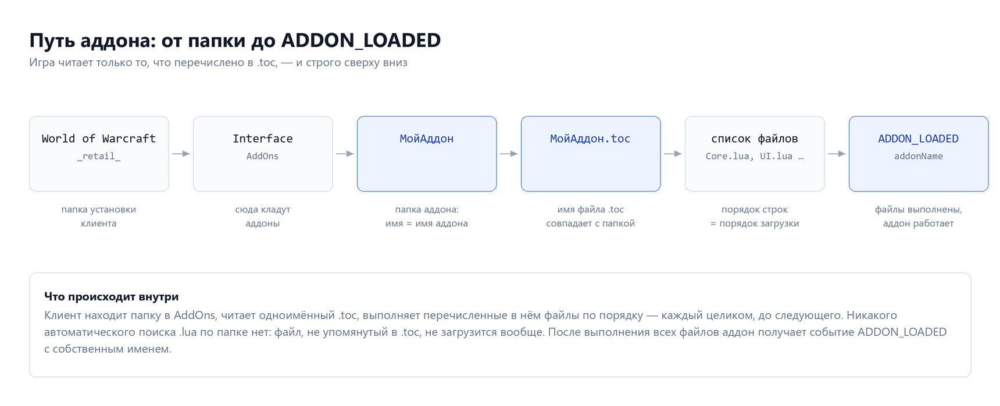

# 1. Что такое аддон, как игра его грузит, и файл `.toc`

## 1.1 Зачем это нужно

Аддон — это набор файлов, которые клиент WoW читает **сам, до того как появится мир**.
Никакой компиляции и никакого «подключения» нет: игра находит папку, читает файл-манифест
`.toc`, выполняет перечисленные в нём скрипты по порядку и после этого говорит аддону
«я тебя загрузил» — событием `ADDON_LOADED`.

> «TOC files are addon manifest files, they define the information, contents, metadata, and
> loading conditions and behaviour of addons.»
> — [TOC format](https://warcraft.wiki.gg/wiki/TOC_format)

Из этого следуют три вещи, которые стажёр должен запомнить навсегда:

1. **Файл, не упомянутый в `.toc`, не существует.** Клиент не сканирует папку на `.lua`.
2. **Порядок строк в `.toc` — это порядок выполнения.** Верхний файл может определить
   переменную, которой пользуется нижний; наоборот — нет.
3. **Имя папки = имя `.toc`.** «The TOC file and folder name must match.» —
   [TOC format §Rules](https://warcraft.wiki.gg/wiki/TOC_format#Rules).



## 1.2 Куда ставить аддон

> «In general, you can install an addon by extracting its code into the
> "World of Warcraft\Interface\AddOns" directory.» —
> [AddOn §Installing an addon](https://warcraft.wiki.gg/wiki/AddOn#Installing_an_addon)

Точный путь зависит от платформы; источник перечисляет оба варианта:

| ОС | Куда класть |
|---|---|
| Windows | `...\World of Warcraft\Interface\AddOns\<ИмяАддона>\` (папку `Interface`, если её нет, создать) |
| macOS | `.../World of Warcraft/_retail_/Interface/AddOns/<ИмяАддона>/` |

Проверка «я всё сделал правильно» звучит так:

> «You've done this step correctly if there's now an
> "World of Warcraft\Interface\AddOns\_KittenMod_\_KittenMod_.toc" file» —
> [AddOn §Installing an addon](https://warcraft.wiki.gg/wiki/AddOn#Installing_an_addon)

То есть внутри `AddOns` лежит **папка аддона**, а внутри неё — `.toc` с тем же именем:

```
Interface\AddOns\DropLedger\DropLedger.toc     — правильно
Interface\AddOns\DropLedger\DropLedger\...toc  — двойная вложенность, аддон не найдётся
Interface\AddOns\DropLedger.toc                — .toc без папки, не найдётся
```

После установки аддон появляется в списке: «The "AddOns" button should appear in the lower
left corner of the WoW window… it should appear in the list of addons that shows when you
press the "AddOns" button.» — [AddOn §Installing an addon](https://warcraft.wiki.gg/wiki/AddOn#Installing_an_addon).

## 1.3 Синтаксис `.toc`

Все правила — из [TOC format §Rules](https://warcraft.wiki.gg/wiki/TOC_format#Rules), цитаты
приведены дословно:

| Правило | Цитата источника |
|---|---|
| Расширение | «The file extension suffix for TOC files is `.toc`.» |
| Имена | «The TOC file and folder name must match.» |
| Директивы | «Directives as `## Directive: Value`» |
| Комментарии | «Comments as `# this is a comment`» |
| Файлы | «A list of files as `myFile.xml` or `subfolder\myFile.lua`» |
| Что перечислять | «Only Lua and XML files need to be listed (not media such as images, fonts, and sounds).» |
| Порядок | «Files are loaded sequentially from top to bottom.» |
| Разделители пути | «Backslashes (`\`) are recommended instead of forward slashes (`/`) for paths» |
| Пробелы | «Whitespace before `#` will be interpreted as the start of a filename» |
| Длина строки | «The game reads up to the first 1024 characters of each line only.» |
| Новые файлы | «Newly created/added files (and even complete addons) are detected when doing a `/reload`» |
| Удалённые/переименованные | «If you delete or rename a TOC file already loaded by the game you will however need a full game restart.» |

Обратите внимание на две ловушки:

* **Пробел перед `#`** превращает комментарий в имя файла. ` # комментарий` — ошибка,
  `# комментарий` — правильно.
* **Удаление или переименование `.toc`** требует полного перезапуска игры: `/reload`
  здесь не спасает.

## 1.4 Директивы: полный список

Общее правило: «Generally, if an addon directive is specified multiple times, the last one…
will be used… Where multiple values are supported, they may be delimited by commas.» —
[TOC format §Addon directives](https://warcraft.wiki.gg/wiki/TOC_format#Addon_directives).

### Метаданные и внешний вид

| Директива | Что делает (цитата) | Ссылка |
|---|---|---|
| `## Interface` | «Defines which interface versions the addon supports… for 12.1.5, the interface version is 120105» | [#Interface](https://warcraft.wiki.gg/wiki/TOC_format#Interface) |
| `## Title` / `## Title-ruRU` … | «Name displayed in the AddOn List.» | [#Title](https://warcraft.wiki.gg/wiki/TOC_format#Title) |
| `## Notes` / `## Notes-ruRU` … | «Tooltip displayed in the AddOn List.» | [#Notes](https://warcraft.wiki.gg/wiki/TOC_format#Notes) |
| `## Author` | «The addon author's name.» | [#Author](https://warcraft.wiki.gg/wiki/TOC_format#Author) |
| `## Version` | «The addon version, which will be shown in the tooltip in the AddOn List.» | [#Version](https://warcraft.wiki.gg/wiki/TOC_format#Version) |
| `## Category` | «Category name displayed in the AddOn List, displayed as a collapsible header entry.» | [#Category](https://warcraft.wiki.gg/wiki/TOC_format#Category) |
| `## Group` | «Addon used for grouping multiple addons together in the AddOn List.» | [#Group](https://warcraft.wiki.gg/wiki/TOC_format#Group) |
| `## IconTexture` | «Path to a texture file to be shown as the icon for this addon in the AddOn List.» | [#IconTexture](https://warcraft.wiki.gg/wiki/TOC_format#IconTexture) |
| `## IconAtlas` | «Name of a texture atlas… Has a lower priority than IconTexture if both are set.» | [#IconAtlas](https://warcraft.wiki.gg/wiki/TOC_format#IconAtlas) |
| `## AddonCompartmentFunc` | «Name of a global function to be executed when the entry for this addon has been clicked in the addon compartment.» | [#AddonCompartmentFunc](https://warcraft.wiki.gg/wiki/TOC_format#AddonCompartmentFunc) |
| `## AddonCompartmentFuncOnEnter` / `…OnLeave` | функции на наведение/уход курсора в том же меню | [#AddonCompartmentFuncOnEnter](https://warcraft.wiki.gg/wiki/TOC_format#AddonCompartmentFuncOnEnter) |
| `## X-___` | «Any custom metadata prefixed by "X-", such as "X-Date", "X-Website" or "X-Feedback"» | [#X-___](https://warcraft.wiki.gg/wiki/TOC_format#X-___) |

### Данные

| Директива | Что делает (цитата) | Ссылка |
|---|---|---|
| `## SavedVariables` | «Global variables to be stored in and read from `WTF\[account]\SavedVariables\MyAddOn.lua`» | [#SavedVariables](https://warcraft.wiki.gg/wiki/TOC_format#SavedVariables) |
| `## SavedVariablesPerCharacter` | то же, но в папке персонажа | [#SavedVariablesPerCharacter](https://warcraft.wiki.gg/wiki/TOC_format#SavedVariablesPerCharacter) |
| `## LoadSavedVariablesFirst` | «Set to `1` if SavedVariables file(s) should be loaded before all script files for this addon.» | [#LoadSavedVariablesFirst](https://warcraft.wiki.gg/wiki/TOC_format#LoadSavedVariablesFirst) |

### Загрузка

| Директива | Что делает (цитата) | Ссылка |
|---|---|---|
| `## LoadOnDemand` | «Set to `1` to delay loading until `C_AddOns.LoadAddOn` is called.» | [#LoadOnDemand](https://warcraft.wiki.gg/wiki/TOC_format#LoadOnDemand) |
| `## Dependencies` (алиасы `RequiredDeps`, `Dep…`) | «Addons that must load first.» | [#Dependencies](https://warcraft.wiki.gg/wiki/TOC_format#Dependencies) |
| `## OptionalDeps` | «Addons that must load first if available.» | [#OptionalDeps](https://warcraft.wiki.gg/wiki/TOC_format#OptionalDeps) |
| `## LoadWith` | «Addons that, once loaded, will trigger this one to load.» | [#LoadWith](https://warcraft.wiki.gg/wiki/TOC_format#LoadWith) |
| `## LoadManagers` | «Addons that, if present, will cause this one to behave as `LoadOnDemand`.» | [#LoadManagers](https://warcraft.wiki.gg/wiki/TOC_format#LoadManagers) |
| `## AllowLoadGameType` | «Restricts loading this addon to case-insensitive game types» | [#AllowLoadGameType](https://warcraft.wiki.gg/wiki/TOC_format#AllowLoadGameType) |
| `## ExcludeLoadGameType` | обратное ограничение | [#ExcludeLoadGameType](https://warcraft.wiki.gg/wiki/TOC_format#ExcludeLoadGameType) |
| `## OnlyBetaAndPTR` | «Set to `1` if an addon should only be loadable in Beta or PTR clients.» | [#OnlyBetaAndPTR](https://warcraft.wiki.gg/wiki/TOC_format#OnlyBetaAndPTR) |
| `## DefaultState` | «Set to `disabled` to require the user to explicitly enable the addon» | [#DefaultState](https://warcraft.wiki.gg/wiki/TOC_format#DefaultState) |

### Служебные (для сторонних аддонов закрыты)

> «The following addon directives are inaccessible to third-party addons.»
> — [TOC format §Restricted](https://warcraft.wiki.gg/wiki/TOC_format#Restricted)

`## AllowLoad`, `## EscalateErrorDuringLoad`, `## LoadFirst`, `## SavedVariablesMachine`,
`## UseSecureEnvironment`. В учебнике они нужны только для того, чтобы стажёр не пугался,
встретив их в чужих `.toc`. Полезное исключение:

| Директива | Цитата | Ссылка |
|---|---|---|
| `## AllowAddOnTableAccess` | «Set to `1` to allow the retrieval of the namespace table of this addon via `C_AddOns.GetAddOnLocalTable`.» | [#AllowAddOnTableAccess](https://warcraft.wiki.gg/wiki/TOC_format#AllowAddOnTableAccess) |

### Варианты имён файла `.toc`

> «The game first searches for TOC files with these suffixes … and if none are found to match
> its game type (or its aliases) it will default to `AddOnName.toc` without a suffix.»
> — [TOC format §Naming](https://warcraft.wiki.gg/wiki/TOC_format#Naming)

Суффиксы, перечисленные в источнике: `_Standard`, `_Forever`/`_Camelot`, `_Mists`, `_Cata`,
`_Wrath`, `_TBC`, `_Vanilla`, `_Plunderstorm`/`_WoWLabs`, `_WoWHack`, семейные `_Mainline`,
`_Classic`. В самом клиенте из 374 `.toc` чаще всего встречаются `_Mainline` (45) и
`_Classic` (21) — это видно по дереву
[Gethe/wow-ui-source](https://github.com/Gethe/wow-ui-source).

Ещё в `.toc` поддерживаются переменные в путях:

> «TOC files support the use of variable expansions for files. They use the syntax `[Variable]`,
> and can appear anywhere in a line.» — [TOC format §Variables](https://warcraft.wiki.gg/wiki/TOC_format#Variables)

Доступны `Family`, `Game`, `TextLocale`, `RegionalTextLocale`. Живой пример из клиента —
`Blizzard_AuctionHouseUI.toc`: строка `[Family]\Blizzard_AuctionHouseUtil.lua`
([live/Interface/AddOns/Blizzard_AuctionHouseUI](https://raw.githubusercontent.com/Gethe/wow-ui-source/live/Interface/AddOns/Blizzard_AuctionHouseUI/Blizzard_AuctionHouseUI.toc)).

## 1.5 `## Interface`: число, которое решает, загрузишься ли ты

> «An interface version is a single number representation of a client version (e.g., for
> 12.1.5, the interface version is 120105).» — [TOC format §Interface](https://warcraft.wiki.gg/wiki/TOC_format#Interface)

Правило сборки числа: версия без точек и ведущих нулей. `12.1.5` → `120105`, `9.0.2` → `90002`
([Getting the current interface number](https://warcraft.wiki.gg/wiki/Getting_the_current_interface_number)).

Актуальные значения (источник сам предупреждает: «These values are maintained by
contributors, so they may not always be up to date»):

| Тип игры | Interface | Откуда |
|---|---|---|
| Standard (Midnight) | **120105** | [TOC format §Interface](https://warcraft.wiki.gg/wiki/TOC_format#Interface), совпадает с `version.txt` = `12.1.5.70961` в [Gethe](https://raw.githubusercontent.com/Gethe/wow-ui-source/live/version.txt) |
| Standard Test/PTR | 120107 | там же |
| Mists | 50504 | там же |
| Wrath (Titan Reforged) | 38002 | там же |
| TBC Anniversary | 20506 | там же |
| Forever | 16001 | там же |
| Vanilla | 11509 | там же |

Несколько значений сразу поддерживаются:

```
## Interface: 120105, 16001, 50504, 11509
```

Что будет при несовпадении — **две формулировки источников**:

* «the WoW client skips over any AddOn whose interface version does not match its own» —
  [Getting the current interface number](https://warcraft.wiki.gg/wiki/Getting_the_current_interface_number);
* «will be displayed as "out of date"… and will not be loaded by default… To enable loading of
  addons that appear "out of date," check the "Load out of date AddOns" checkbox» —
  [AddOn §Loading out-of-date addons](https://warcraft.wiki.gg/wiki/AddOn#Loading_out-of-date_addons).
  Там же: «Blizzard automatically clears this checkbox with every client patch».

Проверить своё число в игре: `/dump select(4, GetBuildInfo())`
([API:GetBuildInfo](https://warcraft.wiki.gg/wiki/API:GetBuildInfo)).

## 1.6 Настоящий `.toc` нашего аддона

`DropLedger.toc`, строки 1–26 (полный файл — 59 строк: дальше идёт список из 38 файлов):

```lua
## Interface: 120105
## Title: Drop Ledger
## Title-ruRU: Счётчик дропа
## Notes: Отслеживание редкого дропа: попытки, шанс, статистика по персонажу и аккаунту
## Notes-ruRU: Статистика выпадения редких вещей: попытки, шанс с Wowhead, сводка по аккаунту
## Notes-deDE: Seltenes Beute-Glück verfolgen: Versuche, Chance, Statistik pro Charakter und Account
...
## Author: lead
## Version: 1.13.6
## SavedVariables: DropLedgerDB
## SavedVariablesPerCharacter: DropLedgerCharDB
## IconTexture: Interface\Icons\INV_Misc_Coin_01

Locale.lua
Locale_en.lua
Locale_de.lua
...
Core.lua
Data.lua
...
UI.lua
Popup.lua
```

Разбор решений (это не случайность, а опыт):

* `Interface: 120105` — ровно версия клиента, на которой аддон выпускался.
* `Notes-<локаль>` на 12 языках — строка подсказки в списке аддонов берётся по языку
  клиента; в вики такой механизм проиллюстрирован примером `## Title-frFR: En attendant Godot`
  ([#Title](https://warcraft.wiki.gg/wiki/TOC_format#Title)).
* **Две** переменные: `DropLedgerDB` (аккаунт) и `DropLedgerCharDB` (персонаж). Почему так —
  раздел 7.
* Порядок файлов: сначала словари и оформление, потом ядро, потом данные, потом интерфейс.
  Нижний файл может пользоваться тем, что определено выше (см. 2.7).
* В `.toc` нет ни одной картинки и ни одного `.xml`, кроме `Bindings.xml` — «Only Lua and XML
  files need to be listed».

## 1.7 Минимальный `.toc` для первого аддона

```lua
## Interface: 120105
## Title: Hello World
## Title-ruRU: Привет, мир
## Notes: Минимальный аддон: события, слэш-команда, сохранение счётчика
## Author: intern
## Version: 1.0.0
## SavedVariables: HelloWorldDB
## IconTexture: Interface\Icons\INV_Misc_QuestionMark

HelloWorld.lua
```

Пять директив — обязательный минимум для человека: `Interface`, `Title`, `Notes`, `Version`,
`Author`. Плюс `SavedVariables`, если аддон что-то запоминает. `IconTexture` — по желанию,
но без неё в списке аддонов будет пустой квадрат.

## 1.8 Частые ошибки новичка

| Симптом | Причина | Лечение | Источник |
|---|---|---|---|
| Аддона нет в списке | `.toc` лежит не в папке, а рядом; или имена папки и файла разные | сверить `AddOns\<Имя>\<Имя>.toc` | [TOC format §Rules](https://warcraft.wiki.gg/wiki/TOC_format#Rules) |
| Аддон есть, но «мёртвый» | `.lua` не перечислен в `.toc` | добавить строку с именем файла | там же, «A list of files as…» |
| Часть функций «nil» | файл стоит в `.toc` выше того, который его определяет | переставить строки | «Files are loaded sequentially from top to bottom» |
| Аддон «out of date» | `## Interface` меньше клиента | поставить актуальное число | [AddOn §Loading out-of-date addons](https://warcraft.wiki.gg/wiki/AddOn#Loading_out-of-date_addons) |
| Правки не видны | новый файл/папка появляется только после `/reload`, а удалённый `.toc` — только после перезапуска | `/reload`; при переименовании `.toc` — рестарт | [TOC format §Rules](https://warcraft.wiki.gg/wiki/TOC_format#Rules) |
| Комментарий «съел» файл | пробел перед `#` | убрать пробел | там же |
| Долгая строка обрезана | клиент читает 1024 символа строки | не писать километровых строк | там же |

## 1.9 Источники раздела

* [TOC format](https://warcraft.wiki.gg/wiki/TOC_format) — правила, директивы, Interface, переменные, суффиксы.
* [TOC format §Rules](https://warcraft.wiki.gg/wiki/TOC_format#Rules) — синтаксис и ограничения.
* [AddOn](https://warcraft.wiki.gg/wiki/AddOn) — установка, список аддонов, out-of-date.
* [AddOn loading process](https://warcraft.wiki.gg/wiki/AddOn_loading_process) — порядок загрузки.
* [Getting the current interface number](https://warcraft.wiki.gg/wiki/Getting_the_current_interface_number) — формат числа.
* [Gethe/wow-ui-source](https://github.com/Gethe/wow-ui-source) — `version.txt`, реальные `.toc`.
* [FRIKKern/WoW-Midnight-Addon-Template](https://github.com/FRIKKern/WoW-Midnight-Addon-Template) — `template/MyAddon.toc` с комментариями автора.
* `DropLedger.toc` — наш рабочий манифест.
