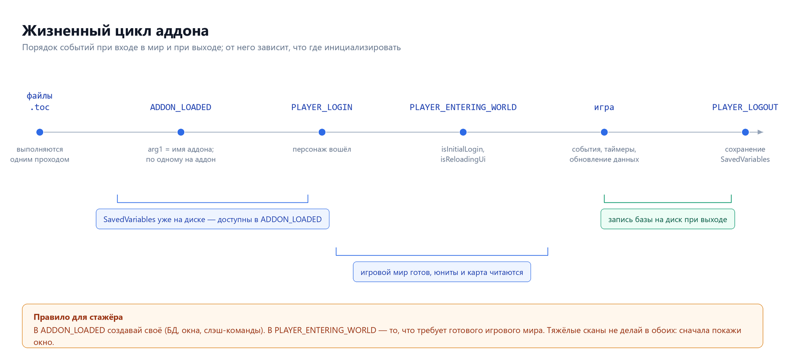

# 3. Жизненный цикл аддона

## 3.1 Зачем это нужно

Между «файлы выполнились» и «можно читать данные игрока» проходит несколько событий. Если
перепутать их местами, аддон либо падает при загрузке, либо показывает пустое окно до первого
`/reload`. Порядок задан клиентом и описан в
[AddOn loading process](https://warcraft.wiki.gg/wiki/AddOn_loading_process).



## 3.2 Точная последовательность при входе

Дословно из [AddOn loading process §Events during login](https://warcraft.wiki.gg/wiki/AddOn_loading_process#Events_during_login):

| № | Событие | Что источник говорит | Что делать аддону |
|---|---|---|---|
| 1 | `ADDON_LOADED: addOnName, containsBindings` | «Fires when each AddOn finishes loading, including all files and saved variables.» | проверить `addOnName`, прочитать `SavedVariables`, создать БД и окна, отписаться |
| 2 | `PLAYER_LOGIN` | «Fires during the loading screen when logging in or reloading, before the first `PLAYER_ENTERING_WORLD`. Most information about the game world is available to the UI.» | одноразовая инициализация, размещение окон |
| 3 | `PLAYER_ENTERING_WORLD: isInitialLogin, isReloadingUi` | «Fires during any loading screen including logging in, reloading or entering an instance.» | то, что зависит от мира: зона, инстанс, таланты |
| 4 | `PLAYER_REGEN_DISABLED` | «Fires when the player is entering combat lockdown.» | доделать правки защищённых фреймов, пока не поздно |
| 5 | `SPELLS_CHANGED` | «Fires when spells in the spellbook is populated, and again when it changes.» | обновить не-защищённые фреймы |

Дальше идёт обычная жизнь: события сыпятся по мере игры.

## 3.3 Точная последовательность при выходе

Дословно из [AddOn loading process §Events during logout](https://warcraft.wiki.gg/wiki/AddOn_loading_process#Events_during_logout):

| № | Событие | Цитата |
|---|---|---|
| 1 | `PLAYER_LEAVING_WORLD` | «Does not imply logout, as it may preceed another loading screen (instances, continents, etc.).» |
| 2 | `PLAYER_LOGOUT` | «Last chance to modify SavedVariables before AddOns unload.» |
| 3 | `ADDONS_UNLOADING` | «All AddOns commit SavedVariables prior to reloading, quitting or logging off. Called once only, rather than for each AddOn. This does not occur during a crash or Alt-F4.» |

> Источник сам помечает два из этих пунктов шаблоном `{{fact}}` — то есть редакторы вики
> считают их неподтверждёнными. Практический вывод не меняется: **последний шанс что-то
> поправить в базе — `PLAYER_LOGOUT`**, а при падении клиента (`Alt-F4`) запись может не
> произойти вовсе.

## 3.4 Главное событие — `ADDON_LOADED`

> «Fires after an AddOn has been loaded.
> ADDON_LOADED: addOnName, containsBindings
> … addOnName: string - The name of the addon. … containsBindings: boolean
> * An addon is loaded after all .lua files have been run and SavedVariables have loaded.
> * … this is the first time an AddOn can access its saved variables.»
> — [Event:ADDON_LOADED](https://warcraft.wiki.gg/wiki/Event:ADDON_LOADED)

Три следствия:

1. **`SavedVariables` в момент выполнения файлов ещё `nil`.** Всё, что нужно из базы, читаем
   в обработчике.
2. **Событие приходит на каждый аддон.** В обработчике обязательна проверка arg1, иначе
   инициализация выполнится столько раз, сколько аддонов загружено.
3. **Отписаться.** Источник советует прямо: «deregister from ADDON_LOADED to avoid repeated
   callbacks» ([AddOn loading process](https://warcraft.wiki.gg/wiki/AddOn_loading_process)).

Формулировки «ровно один раз на аддон» в источниках нет — есть «fires when each AddOn finishes
loading». На практике одного вызова на аддон достаточно, но полагаться на это не нужно:
`UnregisterEvent` после первой обработки снимает вопрос навсегда.

## 3.5 Остальные события загрузки

| Событие | Аргументы (источник) | Заметки |
|---|---|---|
| `PLAYER_LOGIN` | нет — «Payload: None» ([Event:PLAYER_LOGIN](https://warcraft.wiki.gg/wiki/Event:PLAYER_LOGIN)) | «Triggered immediately before PLAYER_ENTERING_WORLD on login and UI Reload, but NOT when entering/leaving instances.» |
| `PLAYER_ENTERING_WORLD` | `isInitialLogin: boolean`, `isReloadingUi: boolean` ([Event:PLAYER_ENTERING_WORLD](https://warcraft.wiki.gg/wiki/Event:PLAYER_ENTERING_WORLD)) | «True whenever the character logs in. This includes logging out to character select and then logging in again.» |
| `PLAYER_LOGOUT` | нет ([Event:PLAYER_LOGOUT](https://warcraft.wiki.gg/wiki/Event:PLAYER_LOGOUT)) | «Sent when the player logs out or the UI is reloaded, just before SavedVariables are saved.» |
| `ADDONS_UNLOADING` | `closingClient` ([Events](https://warcraft.wiki.gg/wiki/Events)) | один вызов на весь клиент |
| `VARIABLES_LOADED` | нет ([Event:VARIABLES_LOADED](https://warcraft.wiki.gg/wiki/Event:VARIABLES_LOADED)) | «no longer has a guaranteed order that can be relied on»; «Addons should not use this event to check if their addon's saved variables have loaded.» |
| `SAVED_VARIABLES_TOO_LARGE` | `addOnName` ([Event:SAVED_VARIABLES_TOO_LARGE](https://warcraft.wiki.gg/wiki/Event:SAVED_VARIABLES_TOO_LARGE)) | «Fires when the client runs out of memory while attempting to load saved variables, after ADDON_LOADED»; «SavedVariables will not save on the next logout.» |
| `PLAYER_LEVEL_UP` | `level, healthDelta, powerDelta, numNewTalents, numNewPvpTalentSlots, strengthDelta, agilityDelta, staminaDelta, intellectDelta` ([Event:PLAYER_LEVEL_UP](https://warcraft.wiki.gg/wiki/Event:PLAYER_LEVEL_UP)) | все `number` |
| `UI_SCALE_CHANGED`, `DISPLAY_SIZE_CHANGED` | нет | пересчёт позиций после смены масштаба/разрешения |
| `LUA_WARNING` | `warningText: string` ([Event:LUA_WARNING](https://warcraft.wiki.gg/wiki/Event:LUA_WARNING)) | с 11.1.5 первый параметр `warnType` убран |

## 3.6 Наш рабочий шаблон загрузки

`DropLedger/Core.lua:1031-1130` — эталон, который копируется в каждый новый аддон:

```lua
local boot = CreateFrame("Frame")
boot:RegisterEvent("ADDON_LOADED")

boot:SetScript("OnEvent", function(self, event, arg1)
    if event ~= "ADDON_LOADED" or arg1 ~= ADDON then return end
    self:UnregisterEvent("ADDON_LOADED")

    DropLedgerDB     = ApplyDefaults(DEFAULTS, DropLedgerDB)
    DropLedgerCharDB = ApplyDefaults({ items = {}, fish = {} }, DropLedgerCharDB)
    ns.db = DropLedgerDB

    local okSync, errSync = pcall(ns.SyncChar)
    if not okSync then ns.Debug("SyncChar: %s", tostring(errSync)) end

    ns:RegisterSlash()

    local function StartDetect()
        if ns.DetectStart then
            local ok, err = pcall(ns.DetectStart)
            if not ok then ns.Debug('DetectStart: %s', tostring(err)) end
        end
        if ns.Kills and ns.Kills.Register then
            local okK, errK = pcall(ns.Kills.Register)
            if not okK then ns.Debug('Kills.Register: %s', tostring(errK)) end
        end
    end
    if C_Timer and C_Timer.After then
        C_Timer.After(0, StartDetect)
    else
        StartDetect()
    end
```

Разбор по строкам:

| Строка | Что делает | Почему так |
|---|---|---|
| `local boot = CreateFrame("Frame")` | анонимный фрейм только под события | ему не нужны ни родитель, ни размер — он не рисуется |
| `boot:RegisterEvent("ADDON_LOADED")` | подписка | одна строка на событие |
| `if event ~= "ADDON_LOADED" or arg1 ~= ADDON then return end` | фильтр | событие приходит на все аддоны |
| `self:UnregisterEvent("ADDON_LOADED")` | отписка | инициализация не должна повторяться |
| `ApplyDefaults(...)` | дополнение базы | старые сохранения не содержат новых полей |
| `pcall(ns.SyncChar)` | необязательный шаг | ошибка синхронизации не должна ронять загрузку |
| `C_Timer.After(0, StartDetect)` | регистрация событий на следующий кадр | комментарий в коде: «внутри ADDON_LOADED защищённые вызовы (`RegisterEvent`) иногда помечаются как taint» |

Ветка «на следующий кадр» — не суеверие: она разводит создание фреймов и подписку на
игровые события, чтобы к моменту подписки мир уже существовал. `C_Timer.After(0, f)` по
документации «With a duration of 0 ms, the earliest the callback will be called is on the next
frame» ([API:C_Timer.After](https://warcraft.wiki.gg/wiki/API:C_Timer.After)).

## 3.7 Куда что класть: шпаргалка

| Что делаем | Где | Почему |
|---|---|---|
| читаем `SavedVariables` | `ADDON_LOADED` | раньше они `nil` |
| создаём своё окно | `ADDON_LOADED` | после `/reload` окно должно появиться сразу |
| ставим окно на место, если нет сохранённой позиции | `PLAYER_LOGIN` | «Finish any one-time initialization and frame placement» |
| читаем зону/инстанс, таланты, состав группы | `PLAYER_ENTERING_WORLD` | мир уже есть |
| чиним защищённые фреймы | до `PLAYER_REGEN_DISABLED` | в бою нельзя |
| пишем «последние» правки в базу | `PLAYER_LOGOUT` | «last chance to modify SavedVariables» |

## 3.8 Частые ошибки новичка

| Симптом | Причина | Источник |
|---|---|---|
| `attempt to index a nil value (global 'MyDB')` | читаем базу в файле, а не в `ADDON_LOADED` | [Event:ADDON_LOADED](https://warcraft.wiki.gg/wiki/Event:ADDON_LOADED) |
| Инициализация выполнилась N раз, окно создалось N раз | не проверили `arg1` | там же |
| После `/reload` пусто | данные читаются в `VARIABLES_LOADED`, порядок которого «no longer has a guaranteed order» | [Event:VARIABLES_LOADED](https://warcraft.wiki.gg/wiki/Event:VARIABLES_LOADED) |
| Окно «прыгает» при входе в инстанс | позиция пересчитывается в `PLAYER_ENTERING_WORLD` без проверки `isInitialLogin` | [Event:PLAYER_ENTERING_WORLD](https://warcraft.wiki.gg/wiki/Event:PLAYER_ENTERING_WORLD) |
| Настройки не сохранились после `Alt-F4` | `ADDONS_UNLOADING` «does not occur during a crash or Alt-F4» | [AddOn loading process](https://warcraft.wiki.gg/wiki/AddOn_loading_process#Events_during_logout) |
| База не сохранилась совсем | сработал `SAVED_VARIABLES_TOO_LARGE` | [Event:SAVED_VARIABLES_TOO_LARGE](https://warcraft.wiki.gg/wiki/Event:SAVED_VARIABLES_TOO_LARGE) |

## 3.9 Источники раздела

* [AddOn loading process](https://warcraft.wiki.gg/wiki/AddOn_loading_process) — обе последовательности, советы «что где делать».
* [Event:ADDON_LOADED](https://warcraft.wiki.gg/wiki/Event:ADDON_LOADED), [Event:PLAYER_LOGIN](https://warcraft.wiki.gg/wiki/Event:PLAYER_LOGIN), [Event:PLAYER_ENTERING_WORLD](https://warcraft.wiki.gg/wiki/Event:PLAYER_ENTERING_WORLD), [Event:PLAYER_LOGOUT](https://warcraft.wiki.gg/wiki/Event:PLAYER_LOGOUT), [Event:VARIABLES_LOADED](https://warcraft.wiki.gg/wiki/Event:VARIABLES_LOADED), [Event:SAVED_VARIABLES_TOO_LARGE](https://warcraft.wiki.gg/wiki/Event:SAVED_VARIABLES_TOO_LARGE) — аргументы.
* [Events](https://warcraft.wiki.gg/wiki/Events) — сводный список событий по системам.
* [API:C_Timer.After](https://warcraft.wiki.gg/wiki/API:C_Timer.After) — «earliest … on the next frame».
* `DropLedger/Core.lua:1031-1180` — рабочий стартовый блок.
