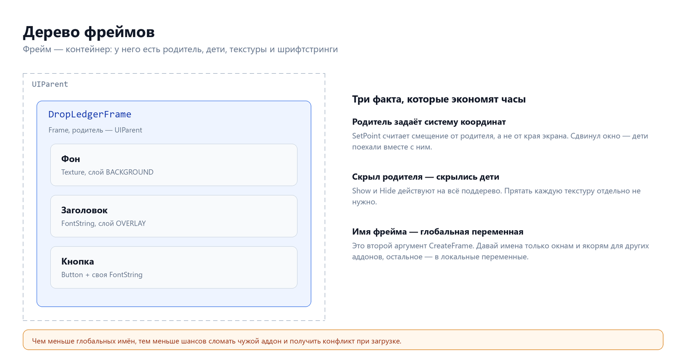
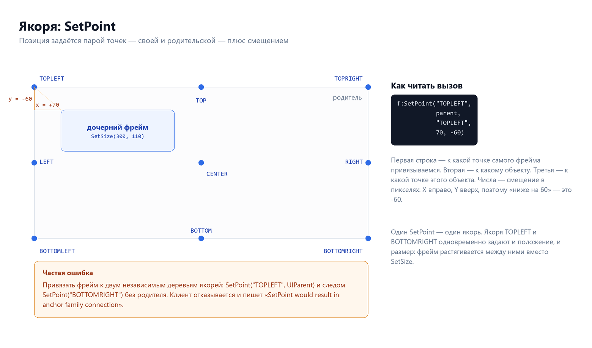
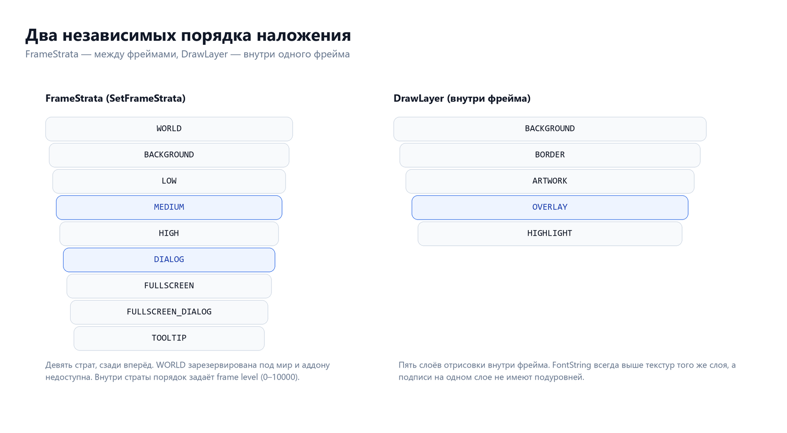

# 4. Фреймы: CreateFrame, якоря, размеры, слои, шаблоны

## 4.1 Зачем это нужно

Фрейм — это прямоугольник, который умеет: быть родителем, принимать мышь, получать события и
рисовать внутри себя текстуры и текст. Всё, что видит игрок в аддоне, — либо фрейм, либо
«регион» внутри фрейма (текстура, шрифтстринг, линия, маска).



## 4.2 `CreateFrame`

> `frame = CreateFrame(frameType [, name [, parent [, template [, id]]]])`
> — [API:CreateFrame](https://warcraft.wiki.gg/wiki/API:CreateFrame)

| Аргумент | Что это (цитата) |
|---|---|
| `frameType` | «Type of the frame; e.g. "Frame" or "Button".» |
| `name` | «Globally accessible name to assign to the frame, or `nil` for an anonymous frame.» |
| `parent` | «Parent object to assign to the frame, or `nil` to be parentless; cannot be a string.» |
| `template` | «Comma-delimited list of virtual XML templates to inherit» |
| `id` | «ID to assign to the frame. Can also be set with Frame:SetID()» |
| возврат | «The created Frame object or one of the other frame type objects.» |

Два предупреждения из той же страницы:

> «Fires the frame's OnLoad script, if it has one from an inherited template.»
> «Frames cannot be deleted or garbage collected, so it may be preferable to reuse them.»

Второе — про производительность: создание фрейма в `OnUpdate` или в цикле по 500 предметам
оставит 500 фреймов навсегда. Поэтому в списках делают пул строк (см. 8.6).

### Типы фреймов

Источник говорит: «Possible frame types are available from the XML schema (UI.xsd), including
Intrinsic frame types» ([API:CreateFrame](https://warcraft.wiki.gg/wiki/API:CreateFrame)) и
перечисляет их. Полный список из источника:

**Обычные:** `Frame`, `ArchaeologyDigSiteFrame`, `Button`, `CheckButton`, `CinematicModel`,
`ColorSelect`, `Cooldown`, `DressUpModel`, `EditBox`, `FogOfWarFrame`, `GameTooltip`,
`MessageFrame`, `Model`, `ModelScene`, `MovieFrame`, `PlayerModel`, `QuestPOIFrame`,
`ScenarioPOIFrame`, `ScrollFrame`, `SimpleHTML`, `Slider`, `StatusBar`, `TabardModel`,
`UiCamera`, `UnitPositionFrame`.

**Intrinsic:** `AuraButton`, `AuraContainer`, `ContainedAlertFrame`, `DropdownButton`,
`DropDownToggleButton`, `EventButton`, `EventEditBox`, `EventFrame`, `EventScrollFrame`,
`ItemButton`, `ScrollingMessageFrame`, `UIThemeContainerFrame`.

Практический минимум стажёра: `Frame` (контейнер), `Button` (клик), `ScrollFrame`
(прокрутка), `EditBox` (ввод), `StatusBar` (полоска), `GameTooltip` (подсказка),
`DressUpModel` (примерочная).

> Внимание: отдельного типа `CheckBox` нет — только `CheckButton`; камера называется
> `UiCamera`, не `Camera`. Это дословно список источника.

Живой пример из документации:

```lua
local btn = CreateFrame("Button", nil, UIParent, "UIPanelButtonTemplate")
btn:SetPoint("CENTER"); btn:SetSize(100, 40); btn:SetText("Click me")
btn:SetScript("OnClick", function(self, button, down)
    print("Pressed", button, down and "down" or "up")
end)
btn:RegisterForClicks("AnyDown", "AnyUp")
```
— [API:CreateFrame](https://warcraft.wiki.gg/wiki/API:CreateFrame)

## 4.3 Якоря: `SetPoint`

> `ScriptRegionResizing:SetPoint(point [, relativeTo [, relativePoint]] [, offsetX, offsetY])`
> — [API:ScriptRegionResizing_SetPoint](https://warcraft.wiki.gg/wiki/API:ScriptRegionResizing_SetPoint)

| Аргумент | Что это (цитата) |
|---|---|
| `point` | «The point of this region.» |
| `relativeTo` | «The reference or name of the other region. For example `UIParent` or `"UIParent"`.» / «If omitted, anchors to the parent region if applicable, otherwise to the screen dimensions.» |
| `relativePoint` | «The point of the other region to anchor to. If omitted, defaults to `point`.» |
| `offsetX` | «Offset right (negative for left). Requires `offsetY` to be specified.» |
| `offsetY` | «Offset up (negative for down). Requires `offsetX` to be specified.» |

Девять точек — [FramePoint](https://warcraft.wiki.gg/wiki/FramePoint): `TOPLEFT`, `TOP`,
`TOPRIGHT`, `LEFT`, `CENTER`, `RIGHT`, `BOTTOMLEFT`, `BOTTOM`, `BOTTOMRIGHT`.



Все допустимые формы вызова (из примера источника):

```lua
f:SetPoint("BOTTOMLEFT")                              -- к родителю, той же точкой, без смещения
f:SetPoint("BOTTOMLEFT", 0, 0)                        -- к родителю, со смещением
f:SetPoint("BOTTOMLEFT", UIParent)                    -- к UIParent
f:SetPoint("BOTTOMLEFT", UIParent, 0, 0)
f:SetPoint("BOTTOMLEFT", UIParent, "BOTTOMLEFT")
f:SetPoint("BOTTOMLEFT", "UIParent", "BOTTOMLEFT")    -- имя строкой тоже можно
f:SetPoint("BOTTOMLEFT", UIParent, "BOTTOMLEFT", 0, 0) -- полная форма
```

### Что ломается

> «Action[SetPoint] failed because[SetPoint would result in anchor family connection]»
> — [API:ScriptRegionResizing_SetPoint](https://warcraft.wiki.gg/wiki/API:ScriptRegionResizing_SetPoint)

Пример из источника ровно такой: фрейм привязали `TOPLEFT`-ом к `UIParent`, а потом
`SetPoint("BOTTOMRIGHT")` без родителя — и получили ошибку, потому что вторая точка тянет
фрейм в другое дерево якорей. Ещё из той же страницы: «Protected frames may silently ignore
calls to this function if the relative frame is a FontString» и «UI scaling affects the
distances for offsetX and offsetY».

## 4.4 Размеры

| Метод | Сигнатура и цитата | Ссылка |
|---|---|---|
| `SetSize` | `SetSize(width, height)` — «If the width/height is inferred from anchor points, then setting it has no effect.» | [API:ScriptRegionResizing_SetSize](https://warcraft.wiki.gg/wiki/API:ScriptRegionResizing_SetSize) |
| `SetWidth` / `SetHeight` | по одному измерению | там же |
| `SetAllPoints` | `SetAllPoints([relativeTo, doResize])` — «Only the TOPLEFT and BOTTOMRIGHT points will be set.» | [API:ScriptRegionResizing_SetAllPoints](https://warcraft.wiki.gg/wiki/API:ScriptRegionResizing_SetAllPoints) |
| `ClearAllPoints` | «Removes all anchor points from the region.» | [API:ScriptRegionResizing_ClearAllPoints](https://warcraft.wiki.gg/wiki/API:ScriptRegionResizing_ClearAllPoints) |
| `GetSize` / `GetWidth` / `GetHeight` | `ignoreRect` — «If true, will only return the explicit size of this region and ignores any implicit size inferred from anchor points or contents.» | [API:ScriptRegion_GetWidth](https://warcraft.wiki.gg/wiki/API:ScriptRegion_GetWidth) |

Три правила, которые спасают от часов отладки:

1. **`SetSize` после `SetAllPoints` ничего не делает** — размер уже выведен из якорей
   (в источнике приведён именно такой пример: `GetSize()` остаётся размером родителя).
2. **Два якоря по противоположным углам = размер.** `TOPLEFT` + `BOTTOMRIGHT` заменяют
   `SetSize`.
3. Начиная с 11.2.0 `ClearAllPoints` «immediately invalidates the rect» — измерения надо
   снимать **до** очистки якорей.

## 4.5 Родитель

> «Children inherit alpha and scale unless disallowed with SetIgnoreParentAlpha and
> SetIgnoreParentScale.» — [API:ScriptRegion_SetParent](https://warcraft.wiki.gg/wiki/API:ScriptRegion_SetParent)

> С 10.0.0: «No longer supports accepting a string argument, e.g. "UIParent" instead of
> UIParent.» — там же.

То есть `SetParent("UIParent")` в 12.x — ошибка, нужно `SetParent(UIParent)`. В
`CreateFrame` четвёртый-второй аргумент-родитель тоже должен быть объектом: «cannot be a
string» ([API:CreateFrame](https://warcraft.wiki.gg/wiki/API:CreateFrame)).

Зачем вообще родитель: он задаёт систему координат, наследует масштаб и альфу, и прячет детей
вместе с собой. Корневой родитель для аддонских окон — `UIParent`:

> «Most user interface elements are parented by UIParent that covers the whole screen. Addons
> inserting widgets into the UI should consider making them children of UIParent (or within its
> heirarchy of children) to inherit a common scale.» — [UIParent](https://warcraft.wiki.gg/wiki/UIParent)

## 4.6 Слои: два независимых порядка



### Между фреймами — `FrameStrata`

> «Frame strata… orders each Frame on the screen, affecting how they overlap. These strata
> divide the z-axis into nine intervals (from back to front): WORLD → BACKGROUND → LOW → MEDIUM
> → HIGH → DIALOG → FULLSCREEN → FULLSCREEN_DIALOG → TOOLTIP»
> — [Frame Strata](https://warcraft.wiki.gg/wiki/Frame_Strata)

> «WORLD is reserved for the world frame and cannot be assigned.»
> «Frame levels further divide each strata into smaller intervals, numbered 0-10000.»
> «Every frame defaults to appearing slightly above its parent, sharing the same strata but
> having one level higher.» — там же

**Расхождение источников:** [API types](https://warcraft.wiki.gg/wiki/API_types) даёт другой
перечень — `PARENT, BACKGROUND, LOW, MEDIUM, HIGH, DIALOG, FULLSCREEN, FULLSCREEN_DIALOG,
TOOLTIP, BLIZZARD` (10 значений, включая `PARENT` и `BLIZZARD`, но без `WORLD`). Единого
списка в источниках нет; для практики достаточно знать `MEDIUM` (по умолчанию) и то, что
`DIALOG`/`TOOLTIP` выше.

| Метод | Цитата | Ссылка |
|---|---|---|
| `SetFrameStrata(strata)` | `strata: FrameStrata`; с 11.1.7 «Restricted. Can no longer be called on protected objects by insecure code while in combat.» | [API:Frame_SetFrameStrata](https://warcraft.wiki.gg/wiki/API:Frame_SetFrameStrata) |
| `SetFrameLevel(level)` | «Frames with higher frame level are layered "in front of" frames with a lower frame level.»; 0–10000 | [API:Frame_SetFrameLevel](https://warcraft.wiki.gg/wiki/API:Frame_SetFrameLevel) |

### Внутри фрейма — `DrawLayer`

> «There are five named layers, in the order they are drawn (back to front): BACKGROUND, BORDER,
> ARTWORK, OVERLAY, HIGHLIGHT» — [Layer](https://warcraft.wiki.gg/wiki/Layer)

> «Two widgets in the same layer may be further ordered using a sublayer (or textureSubLevel)
> specified numerically from -8 to 7 (back to front).» — там же

> «Unlike Textures, FontStrings do not support sublayers, and will always be drawn above textures
> sharing the same layer.» — [API:Frame_CreateFontString](https://warcraft.wiki.gg/wiki/API:Frame_CreateFontString)

`HIGHLIGHT` — служебный слой мыши: «Setting Frame:EnableMouse() causes HIGHLIGHT to show/hide
as the cursor hovers the Frame» ([Layer](https://warcraft.wiki.gg/wiki/Layer)).

## 4.7 Текстуры и текст внутри фрейма

| Метод | Сигнатура | Ссылка |
|---|---|---|
| `CreateTexture` | `Frame:CreateTexture([name, drawLayer, templateName, subLevel])`, `subLevel` −8…7 | [API:Frame_CreateTexture](https://warcraft.wiki.gg/wiki/API:Frame_CreateTexture) |
| `CreateFontString` | `Frame:CreateFontString([name, drawLayer, templateName])`, `drawLayer` по умолчанию `ARTWORK` | [API:Frame_CreateFontString](https://warcraft.wiki.gg/wiki/API:Frame_CreateFontString) |
| `SetTexture` | `TextureBase:SetTexture([textureAsset [, wrapModeHorizontal [, wrapModeVertical [, filterMode]]]])`; «To clear the texture call this without any params or nil.»; «PNG files must explicitly include the ".png" extension» | [API:TextureBase_SetTexture](https://warcraft.wiki.gg/wiki/API:TextureBase_SetTexture) |
| `SetText` | `fontString:SetText(text)`; «FontString has a limit of 30,000 characters.»; «The font must be set before showing text.» | [API:FontString_SetText](https://warcraft.wiki.gg/wiki/API:FontString_SetText) |
| `SetFont` | `FontInstance:SetFont(filename, fontHeight, flags)`; флаги `MONOCHROME`, `OUTLINE`, `THICKOUTLINE`, `SLUG`; с 10.0.0 «The flags parameter is no longer optional.» | [API:FontInstance_SetFont](https://warcraft.wiki.gg/wiki/API:FontInstance_SetFont) |

## 4.8 Шаблоны и `BackdropTemplate`

> «Virtual XML templates (or deferred nodes) extend the Widget API by allowing widgets to
> inherit properties.» / «New widgets may inherit templates using a comma-delimited list of
> template names: The inherits="" attribute in XML. The fourth argument in CreateFrame().» /
> «Templates do not reside in the global environment (_G) during runtime; they exist in a
> separate state.» — [Virtual XML template](https://warcraft.wiki.gg/wiki/Virtual_XML_template)

Шаблоны, которые реально встречаются в источниках:

| Шаблон | Что даёт | Ссылка |
|---|---|---|
| `BackdropTemplate` | методы `SetBackdrop`, `SetBackdropColor`, `SetBackdropBorderColor` и т. д. | [BackdropTemplate](https://warcraft.wiki.gg/wiki/BackdropTemplate) |
| `UIPanelButtonTemplate` | «Creates a button which inherits textures and widget scripts from UIPanelButtonTemplate» | [API:CreateFrame](https://warcraft.wiki.gg/wiki/API:CreateFrame) |
| `GameTooltipTemplate` | «Configures a functional GameTooltip» | [GameTooltipTemplate](https://warcraft.wiki.gg/wiki/GameTooltipTemplate) |
| `SharedTooltipTemplate` | «Includes base font strings and textures» | [SharedTooltipTemplate](https://warcraft.wiki.gg/wiki/SharedTooltipTemplate) |
| `BasicFrameTemplateWithInset` | рамка с заголовком и внутренней панелью | [Make frames closable with the Escape key](https://warcraft.wiki.gg/wiki/Make_frames_closable_with_the_Escape_key) |
| `PortraitFrameFlatTemplate`, `PanelDragBarTemplate`, `PanelResizeButtonTemplate` | рамка, полоса перетаскивания, кнопка ресайза | [Making movable and resizable frames](https://warcraft.wiki.gg/wiki/Making_movable_and_resizable_frames) |
| `SecureActionButtonTemplate`, `SecureUnitButtonTemplate`, `InsecureActionButtonTemplate` | кнопки действий/юнитов | [UIOBJECT_Button](https://warcraft.wiki.gg/wiki/UIOBJECT_Button) |

Полного списка шаблонов на вики нет: `XML_templates` — 404, `UIPanelButtonTemplate` —
заглушка. Источник сам отсылает к внешнему `Templates.lua` (Ketho). Это отмечено в плане.

### Ловушка `SetBackdrop`

> `{{widgetmethod|removed=9.0.1|note=The backdrop API has been moved to BackdropTemplate}}`
> Patch 9.0.1: «Removed; replaced with BackdropTemplate»
> — [API:Frame_SetBackdrop](https://warcraft.wiki.gg/wiki/API:Frame_SetBackdrop)

То есть в 12.x `SetBackdrop` **есть только у фрейма, созданного с шаблоном
`BackdropTemplate`**. Без него вызов — ошибка «attempt to call a nil value (method 'SetBackdrop')».

## 4.9 Наш код: панель, кнопка, прокрутка

`DropLedger/UI.lua:145-186` — панель с рамкой, четыре варианта внешнего вида через один
`BackdropTemplate`:

```lua
local function NewPanel(parent, width, height)
    local p = CreateFrame("Frame", nil, parent, "BackdropTemplate")
    p:SetSize(width, height)
    local st = (LAY and LAY.panel) or "border"

    if st == "flat" then
        p:SetBackdrop({ bgFile = WHITE })
        p:SetBackdropColor(C.panel[1], C.panel[2], C.panel[3], C.panel[4])
    elseif st == "accent" then
        p:SetBackdrop({ bgFile = WHITE, edgeFile = WHITE, edgeSize = 1 })
        p:SetBackdropColor(C.panel[1], C.panel[2], C.panel[3], 0.78)
        p:SetBackdropBorderColor(C.border[1], C.border[2], C.border[3], 0.30)
        local bar = p:CreateTexture(nil, "BORDER")
        bar:SetSize(3, height - 10)
        bar:SetPoint("TOPLEFT", p, "TOPLEFT", 0, -5)
        bar:SetColorTexture(C.accent[1], C.accent[2], C.accent[3], 0.95)
        p.accentBar = bar
    elseif st == "line" then
        local top = p:CreateTexture(nil, "BORDER")
        top:SetSize(width, 1)
        top:SetPoint("TOPLEFT", p, "TOPLEFT", 0, 0)
        top:SetColorTexture(C.sep[1], C.sep[2], C.sep[3], 0.9)
        p.topline = top
        ...
```

Что здесь важно pedagogически:

* `CreateFrame("Frame", nil, parent, "BackdropTemplate")` — второй аргумент `nil`, потому что
  имя панели никому не нужно; имя даёт глобал и лишний конфликт.
* `SetSize` до `SetBackdrop` не обязателен по порядку, но так читается лучше: размер — часть
  геометрии, фон — часть вида.
* `edgeSize = 1` — толщина рамки; текстура `WHITE` — встроенная белая заливка, цвет задаётся
  `SetBackdropColor`/`SetColorTexture`.
* Дополнительные полоски — это `CreateTexture(nil, "BORDER")`, то есть **тот же слой**, что и
  рамка, поэтому они рисуются вместе с ней.

Кнопка (`UI.lua:190-235`) добавляет к панели три вещи: подпись-`FontString`, состояния
наведения и `OnClick`:

```lua
local b = CreateFrame("Button", nil, parent, "BackdropTemplate")
b:SetSize(width or 100, height or 20)
b:SetBackdrop({ bgFile = WHITE, edgeFile = WHITE, edgeSize = 1 })
b:SetBackdropColor(BTN_BG[1], BTN_BG[2], BTN_BG[3], 1)
b:SetBackdropBorderColor(BTN_BORDER[1], BTN_BORDER[2], BTN_BORDER[3], 1)

b.label = MakeFS(b, fontSize or 11, C.text, "CENTER", "CENTER", 0, 0)
b.label:SetJustifyH("CENTER")
b.label:SetText(text or "")

b.enabled = true
...
b:SetScript("OnEnter", function(self) ... end)
b:SetScript("OnLeave", function(self) ... end)
```

`MakeFS` — свой хелпер (`UI.lua:130-140`), который создаёт шрифтстринг и сразу задаёт шрифт:

```lua
local function MakeFS(parent, size, color, point, relPoint, x, y)
    local fs = parent:CreateFontString(nil, "OVERLAY", "GameFontHighlightSmall")
    local path, _, flags = fs:GetFont()
    if path then fs:SetFont(path, size or 11, flags) end
    fs:SetPoint(point or "TOPLEFT", parent, relPoint or point or "TOPLEFT", x or 0, y or 0)
    fs:SetJustifyH("LEFT")
    fs:SetTextColor((color or C.text)[1], (color or C.text)[2], (color or C.text)[3])
    return fs
end
```

Обратите внимание на `GetFont()` + `SetFont(path, size, flags)`: взять готовый шрифт клиента и
только поменять размер — надёжнее, чем прописывать путь к `.ttf` руками (в другой локали шрифт
может называться иначе).

## 4.10 Перетаскивание и закрытие по Esc

Перетаскивание — три вызова плюс два обработчика:

```lua
f:SetMovable(true)
f:EnableMouse(true)
f:RegisterForDrag("LeftButton")
f:SetScript("OnDragStart", function(self, button) self:StartMoving() end)
f:SetScript("OnDragStop", function(self) self:StopMovingOrSizing() end)
```

Источники: `SetMovable` — [API:Frame_SetMovable](https://warcraft.wiki.gg/wiki/API:Frame_SetMovable)
(«true to allow the frame to be moved using Frame:StartMoving»),
`RegisterForDrag` — [API:Frame_RegisterForDrag](https://warcraft.wiki.gg/wiki/API:Frame_RegisterForDrag)
(«Enables OnDragStart and OnDragStop script handlers», «Subsequent calls replace any prior ones»),
`OnDragStart` — [UIHANDLER_OnDragStart](https://warcraft.wiki.gg/wiki/UIHANDLER_OnDragStart).
Важное из источника: «Requires calling SetMouseClickEnabled or EnableMouse since this is not
automatically implied by OnDragStart» и «Blocks OnMouseUp and OnClick when dragging with a
registered button».

Закрытие по Esc:

```lua
local frame = CreateFrame("Frame", "MyFrame", UIParent, "BasicFrameTemplateWithInset")
_G["MyFrame"] = frame
tinsert(UISpecialFrames, frame:GetName())
```
— [Make frames closable with the Escape key](https://warcraft.wiki.gg/wiki/Make_frames_closable_with_the_Escape_key)

Условия из источника: «your frame must have a name and be registered in the global variable
list»; и оговорка — «EditBox widgets that have focus will handle the Escape key being pressed by
firing their own OnEscapePressed widget handler, preventing your frame from being closed».

## 4.11 Готовый рецепт: окно с рамкой и перетаскиванием

Минимальное окно аддона, собранное только из описанных выше вызовов:

```lua
local win = CreateFrame("Frame", "MyAddonFrame", UIParent, "BackdropTemplate")
win:SetSize(420, 300)
win:SetPoint("CENTER", UIParent, "CENTER", 0, 0)
win:SetFrameStrata("DIALOG")                 -- выше обычных панелей
win:SetClampedToScreen(true)                 -- не утащить за край экрана
win:SetBackdrop({ bgFile = "Interface\\Buttons\\WHITE8x8",
                  edgeFile = "Interface\\Buttons\\WHITE8x8", edgeSize = 1 })
win:SetBackdropColor(0.05, 0.06, 0.08, 0.95)
win:SetBackdropBorderColor(0.3, 0.3, 0.35, 1)

win.title = win:CreateFontString(nil, "OVERLAY", "GameFontNormal")
win.title:SetPoint("TOPLEFT", win, "TOPLEFT", 12, -10)
win.title:SetText("Мой аддон")

win:SetMovable(true)
win:EnableMouse(true)
win:RegisterForDrag("LeftButton")
win:SetScript("OnDragStart", function(self) self:StartMoving() end)
win:SetScript("OnDragStop", function(self) self:StopMovingOrSizing() end)

tinsert(UISpecialFrames, "MyAddonFrame")     -- Esc закрывает
win:Hide()
```

`SetClampedToScreen` — [API:Frame_SetClampedToScreen](https://warcraft.wiki.gg/wiki/API:Frame_SetClampedToScreen)
(«prevents the frame from being moved partially off-screen»); с 11.1.7 на защищённых фреймах
в бою недоступен.

## 4.12 Частые ошибки новичка

| Симптом | Причина | Источник |
|---|---|---|
| Окно в центре экрана, но «прыгает» | часть детей привязана к `UIParent`, а часть к окну | 4.3, система координат родителя |
| Окно не двигается | нет `SetMovable(true)` и/или `EnableMouse(true)` | [API:Frame_SetMovable](https://warcraft.wiki.gg/wiki/API:Frame_SetMovable), [API:Frame_RegisterForDrag](https://warcraft.wiki.gg/wiki/API:Frame_RegisterForDrag) |
| Esc не закрывает | фрейм без имени или не добавлен в `UISpecialFrames` | [Make frames closable with the Escape key](https://warcraft.wiki.gg/wiki/Make_frames_closable_with_the_Escape_key) |
| `attempt to call method 'SetBackdrop'` | нет шаблона `BackdropTemplate` | [API:Frame_SetBackdrop](https://warcraft.wiki.gg/wiki/API:Frame_SetBackdrop) |
| `SetSize` «не работает» | размер выведен из якорей / стоит `SetAllPoints` | [API:ScriptRegionResizing_SetSize](https://warcraft.wiki.gg/wiki/API:ScriptRegionResizing_SetSize) |
| Ошибка `anchor family connection` | якоря в разные деревья | [API:ScriptRegionResizing_SetPoint](https://warcraft.wiki.gg/wiki/API:ScriptRegionResizing_SetPoint) |
| Текст не видно | подпись создана в слое ниже фона | [Layer](https://warcraft.wiki.gg/wiki/Layer) |
| Подсказка обрезана | не выставлен `SetFont` для многострочного текста | [API:FontString_SetText](https://warcraft.wiki.gg/wiki/API:FontString_SetText) |
| Окно под другими панелями | осталась страта по умолчанию | [Frame Strata](https://warcraft.wiki.gg/wiki/Frame_Strata) |

## 4.13 Источники раздела

* [API:CreateFrame](https://warcraft.wiki.gg/wiki/API:CreateFrame) — сигнатура, типы, пример кнопки.
* [Widget API](https://warcraft.wiki.gg/wiki/Widget_API) — иерархия виджетов.
* [API:ScriptRegionResizing_SetPoint](https://warcraft.wiki.gg/wiki/API:ScriptRegionResizing_SetPoint), [FramePoint](https://warcraft.wiki.gg/wiki/FramePoint), [Anchors](https://warcraft.wiki.gg/wiki/Anchors).
* [API:ScriptRegionResizing_SetSize](https://warcraft.wiki.gg/wiki/API:ScriptRegionResizing_SetSize), [API:ScriptRegionResizing_SetAllPoints](https://warcraft.wiki.gg/wiki/API:ScriptRegionResizing_SetAllPoints), [API:ScriptRegionResizing_ClearAllPoints](https://warcraft.wiki.gg/wiki/API:ScriptRegionResizing_ClearAllPoints).
* [API:ScriptRegion_SetParent](https://warcraft.wiki.gg/wiki/API:ScriptRegion_SetParent), [UIParent](https://warcraft.wiki.gg/wiki/UIParent).
* [Frame Strata](https://warcraft.wiki.gg/wiki/Frame_Strata), [API types](https://warcraft.wiki.gg/wiki/API_types), [Layer](https://warcraft.wiki.gg/wiki/Layer), [SetDrawLayer](https://warcraft.wiki.gg/wiki/SetDrawLayer).
* [BackdropTemplate](https://warcraft.wiki.gg/wiki/BackdropTemplate), [API:Frame_SetBackdrop](https://warcraft.wiki.gg/wiki/API:Frame_SetBackdrop), [Virtual XML template](https://warcraft.wiki.gg/wiki/Virtual_XML_template).
* [Making draggable frames](https://warcraft.wiki.gg/wiki/Making_draggable_frames), [Making movable and resizable frames](https://warcraft.wiki.gg/wiki/Making_movable_and_resizable_frames), [Make frames closable with the Escape key](https://warcraft.wiki.gg/wiki/Make_frames_closable_with_the_Escape_key).
* `DropLedger/UI.lua:130-235` — панель, кнопка, хелпер шрифтстринга.
