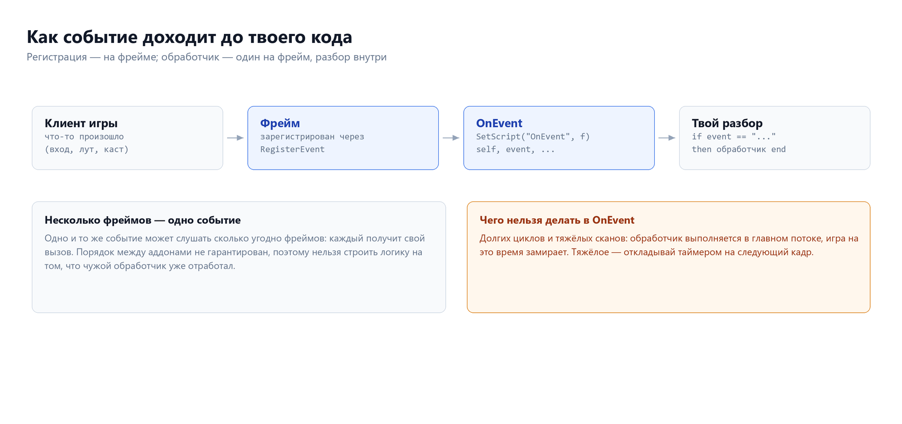

# 5. События: регистрация, обработчик, аргументы

## 5.1 Зачем это нужно

Аддон не может «ждать» — он подписывается на события и получает вызов, когда что-то
произошло. Всё остальное (что именно произошло, с кем, сколько) приходит аргументами.



> «Events are messages sent by the WoW client to UI code (OnEvent script handlers of Frame
> derivatives), mostly in reaction to things occurring in the game world. To process events, an
> addon needs to create an event handler and register it for the events it wishes to receive.»
> — [Handling events](https://warcraft.wiki.gg/wiki/Handling_events)

## 5.2 Сигнатура обработчика

> «The OnEvent handler function receives at least two arguments:
> 1. self, a reference to the frame to which the script handler belongs
> 2. event, the name of the event being fired
> 3. The remaining event arguments are placed within the vararg expression (...)»
> — [Handling events](https://warcraft.wiki.gg/wiki/Handling_events)

> «self : Frame - The registered widget. event : string - Name of the event. ... : Variable
> arguments - The event payload, if any.» — [UIHANDLER_OnEvent](https://warcraft.wiki.gg/wiki/UIHANDLER_OnEvent)

> «The global this, event, and argX variables have been removed in Patch 4.0.1. Instead, use the
> arguments passed to the OnEvent script handler.» — [Handling events](https://warcraft.wiki.gg/wiki/Handling_events)

Минимальный и правильный обработчик:

```lua
local f = CreateFrame("Frame")
f:RegisterEvent("ADDON_LOADED")
f:SetScript("OnEvent", function(self, event, ...)
    local arg1, arg2 = ...
    if event == "ADDON_LOADED" then
        if arg1 ~= "MyAddon" then return end
        -- ...
    end
end)
```

Почему у события один обработчик, а не по функции на событие: `SetScript("OnEvent", fn)`
хранит **одну** функцию на фрейм. Разбор — внутри, по `event`. Если хочется «своя функция на
каждое событие», делается таблица-диспетчер:

```lua
local handlers = {}

handlers["ADDON_LOADED"] = function(self, name) ... end
handlers["PLAYER_LOGIN"] = function(self) ... end

f:SetScript("OnEvent", function(self, event, ...)
    local h = handlers[event]
    if h then h(self, ...) end
end)
```

Именно так устроен шаблон FRIKKern: «Init.lua — Namespace setup, event dispatcher, slash
commands» —
[README шаблона](https://raw.githubusercontent.com/FRIKKern/WoW-Midnight-Addon-Template/HEAD/README.md).

## 5.3 `RegisterEvent` и родня

| Метод | Сигнатура и цитата | Ссылка |
|---|---|---|
| `RegisterEvent` | `registered = Frame:RegisterEvent(eventName)` — «Returns true if the frame is successfully registered to the event. Returns false if the frame was already registered to this event. Throws an error if the event is invalid.» | [API:Frame_RegisterEvent](https://warcraft.wiki.gg/wiki/API:Frame_RegisterEvent) |
| `UnregisterEvent` | `registered = Frame:UnregisterEvent(eventName)` — «Returns true if the event was successfully unregistered, false if already unregistered. Throws an error is the event is invalid.» | [API:Frame_UnregisterEvent](https://warcraft.wiki.gg/wiki/API:Frame_UnregisterEvent) |
| `UnregisterAllEvents` | `Frame:UnregisterAllEvents()` — «Unregisters all events from the frame.» | [API:Frame_UnregisterAllEvents](https://warcraft.wiki.gg/wiki/API:Frame_UnregisterAllEvents) |
| `RegisterUnitEvent` | `registered = Frame:RegisterUnitEvent(eventName, ...units)` | [API:Frame_RegisterUnitEvent](https://warcraft.wiki.gg/wiki/API:Frame_RegisterUnitEvent) |
| `IsEventRegistered` | `isRegistered, ...units = Frame:IsEventRegistered(eventName)` — «Invalid event names always return false.» | [API:Frame_IsEventRegistered](https://warcraft.wiki.gg/wiki/API:Frame_IsEventRegistered) |
| `RegisterAllEvents` | `Frame:RegisterAllEvents()` — «It is not advisable to use this for anything except debugging or datamining purposes, as the incurred performance penalty may be quite large.» | [API:Frame_RegisterAllEvents](https://warcraft.wiki.gg/wiki/API:Frame_RegisterAllEvents) |

Три факта, которые легко забыть:

1. **Опечатка в имени события — не «тишина», а ошибка.** С 8.0.1: «Registering a non-existing
   event now raises an error instead of returning nil» — [API:Frame_RegisterEvent](https://warcraft.wiki.gg/wiki/API:Frame_RegisterEvent).
2. **Повторная регистрация** возвращает `false` и ничего не дублирует.
3. **`RegisterAllEvents` нельзя сочетать с `UnregisterEvent`**: «This internally sets a flag to
   receive all events, so it cannot be used in conjunction with Frame:UnregisterEvent» —
   [API:Frame_RegisterAllEvents](https://warcraft.wiki.gg/wiki/API:Frame_RegisterAllEvents).

## 5.4 `RegisterUnitEvent`: фильтр по юнитам

> «Registers the frame for a specific event, triggering only for the specified units.
> `registered = Frame:RegisterUnitEvent(eventName, ...units)`
> … `...units: Enum.UnitTokenType - A list of units (up to four units)`
> * Repeated calls with the same event will overwrite old registrations. Calling
>   Frame:RegisterEvent will also overwrite the old registration.
> * If no unit is given, then all units will be watched; which is effectively the same as
>   calling Frame:RegisterEvent.»
> — [API:Frame_RegisterUnitEvent](https://warcraft.wiki.gg/wiki/API:Frame_RegisterUnitEvent)

Ограничение «up to four units» — единственный численный лимит по событиям, который вообще
есть в источниках (лимит событий на фрейм нигде не описан, это отмечено в плане).

```lua
local hp = CreateFrame("Frame")
hp:RegisterUnitEvent("UNIT_HEALTH", "player", "target")
hp:SetScript("OnEvent", function(self, event, unit)
    -- событие придёт только для player и target
    print(unit, UnitHealth(unit), UnitHealthMax(unit))
end)
```

## 5.5 Порядок вызова у разных фреймов

> «Event frames are generally notified in the order they were first registered. Holes get up
> filled up eagerly from the back. Insertions are always at the back.» — с примером: после
> `f2:UnregisterEvent` порядок «1, 3», а новый `f4` встаёт в конец.
> — [API:Frame_RegisterEvent §In-Depth Details](https://warcraft.wiki.gg/wiki/API:Frame_RegisterEvent)

Источник сам оговаривается: «Disclaimer: the wiki is not liable if your addon somehow depends
on this and it turns out to be wrong». Вывод: **не строить логику на порядке между аддонами**.

## 5.6 Что появилось в 12.0.0

Кроме `SetScript("OnEvent", …)` теперь есть регистрация колбэка:

| Метод | Сигнатура | Ссылка |
|---|---|---|
| `RegisterEventCallback` | `registered = Frame:RegisterEventCallback(eventName, cb)` — «Patch 12.0.0: Added.» | [API:Frame_RegisterEventCallback](https://warcraft.wiki.gg/wiki/API:Frame_RegisterEventCallback) |
| `RegisterUnitEventCallback` | `registered = Frame:RegisterUnitEventCallback(eventName, cb, ...units)` | [API:Frame_RegisterUnitEventCallback](https://warcraft.wiki.gg/wiki/API:Frame_RegisterUnitEventCallback) |

Состав аргументов типа `FrameEventCallbackType` в источниках **не описан** (таблица пустая) —
поэтому в учебнике этот путь не рекомендуется как основной.

Есть и библиотека Blizzard для того же:

> «EventRegistry:RegisterFrameEventAndCallback(frameEvent, func, [owner], ...) : owner - Registers
> a callback to a Frame Event (e.g. PLAYER_ENTERING_WORLD)»
> — [EventRegistry](https://warcraft.wiki.gg/wiki/EventRegistry)

Пример из источника заодно показывает реальные аргументы `PLAYER_ENTERING_WORLD`:

```lua
EventRegistry:RegisterFrameEventAndCallback("PLAYER_ENTERING_WORLD", function(ownerID, ...)
    print(...) -- on login this prints: "foo", "bar", true, false
end, nil, "foo", "bar")
```

И предупреждение: «if one of the functions registered through the event registry takes too long
to execute (script timeouts) then all the other callbacks for the same event in the registry may
also not get executed» ([EventRegistry](https://warcraft.wiki.gg/wiki/EventRegistry)).

## 5.7 Чего в событиях больше нет (12.x)

> «`COMBAT_LOG_EVENT` and `COMBAT_LOG_EVENT_UNFILTERED` will error when trying to register them.»
> — [Patch 12.0.0/API changes](https://warcraft.wiki.gg/wiki/Patch_12.0.0/API_changes)

> «This event is no longer accessible to addons in Midnight since Patch 12.0.0. Fires
> ADDON_ACTION_FORBIDDEN when attempting to register this event.»
> — [Event:COMBAT_LOG_EVENT](https://warcraft.wiki.gg/wiki/Event:COMBAT_LOG_EVENT)

Причина сформулирована прямо: «API changes have been introduced with an aim to limit the
ability for addons to perform complex logic and decision making based off combat information»
([Patch 12.0.0/API changes](https://warcraft.wiki.gg/wiki/Patch_12.0.0/API_changes)).

Что осталось вместо лога боя: неймспейс `C_CombatLog` и события `COMBAT_LOG_MESSAGE`,
`COMBAT_LOG_EVENT_INTERNAL_UNFILTERED`, `COMBAT_LOG_APPLY_FILTER_SETTINGS` — перечислены в
[Events](https://warcraft.wiki.gg/wiki/Events) (системы `CombatLogInternal`, `CombatLogSecure`).

В DropLedger это учтено явно: аддон **не** подписывается на боевой лог, а считает добычу по
строкам чата `CHAT_MSG_LOOT` и по событию `LOOT_OPENED` (см. 9.6 и 12.5).

## 5.8 Аргументы: где смотреть и как не перепутать

Аргументы каждого события documented на своей странице `Event:<ИМЯ>`; сводный список —
[Events](https://warcraft.wiki.gg/wiki/Events). Примеры, которые нужны чаще всего:

| Событие | Аргументы | Ссылка |
|---|---|---|
| `ADDON_LOADED` | `addOnName, containsBindings` | [Event:ADDON_LOADED](https://warcraft.wiki.gg/wiki/Event:ADDON_LOADED) |
| `PLAYER_ENTERING_WORLD` | `isInitialLogin, isReloadingUi` | [Event:PLAYER_ENTERING_WORLD](https://warcraft.wiki.gg/wiki/Event:PLAYER_ENTERING_WORLD) |
| `UNIT_SPELLCAST_SUCCEEDED` | `unitTarget, castGUID, spellID, castBarID` | [Event:UNIT_SPELLCAST_SUCCEEDED](https://warcraft.wiki.gg/wiki/Event:UNIT_SPELLCAST_SUCCEEDED) |
| `LOOT_OPENED` | `autoLoot, isFromItem` | [Event:LOOT_OPENED](https://warcraft.wiki.gg/wiki/Event:LOOT_OPENED) |
| `PLAYER_LEVEL_UP` | `level, healthDelta, powerDelta, …` (9 чисел) | [Event:PLAYER_LEVEL_UP](https://warcraft.wiki.gg/wiki/Event:PLAYER_LEVEL_UP) |
| `CHAT_MSG_LOOT` | `text, playerName, languageName, …` (17 по сигнатуре события) | [Event:CHAT_MSG_LOOT](https://warcraft.wiki.gg/wiki/Event:CHAT_MSG_LOOT) |

**Расхождение источников по `CHAT_MSG_*`:** в сигнатуре события 17 аргументов, а в шаблоне
[CHAT_MSG](https://warcraft.wiki.gg/wiki/CHAT_MSG) — 18, восемнадцатый `discordInfo:
DiscordChatInfo`. Пользоваться надо первыми (`text`, `playerName`), они совпадают в обоих
описаниях.

Практика: **брать аргументы через `...`, а не позиционными именами в обработчике**, если
событие может поменяться:

```lua
f:SetScript("OnEvent", function(self, event, ...)
    if event == "UNIT_SPELLCAST_SUCCEEDED" then
        local unit, castGUID, spellID = ...
        if unit == "player" then print("каст", spellID) end
    end
end)
```

## 5.9 Наш код: как DropLedger регистрирует события

В аддоне нет «фрейм на событие» — есть один `eventFrame` и своя обёртка
(`DropLedger/Detect.lua:560-650`), которая **не пытается** зарегистрировать запрещённое:

```lua
--  Клиент 12.x считает RegisterEvent на боевой лог защищённым вызовом. pcall
--  тут не спасает: ошибка перехватывается, но нарушение всё равно засчитывается
--  и аддон получает метку ADDON_ACTION_FORBIDDEN. Поэтому такие события не
--  «пробуем и ловим», а не регистрируем вообще.

function ns.RegisterEvent(frame, event)
    local isLog = (event == "COMBAT_LOG_EVENT_UNFILTERED" or event == "COMBAT_LOG_EVENT")
    if CL_ONLY[event] or (isLog and ns.CombatLogClosed()) then
        blockedEvents[event] = true
        return false
    end
    --  события, которых в этом клиенте уже нет (12.x вырезал часть имён):
    --  спрашиваем у клиента, а не у списка, собранного руками
    if C_EventUtils and type(C_EventUtils.IsEventValid) == "function" then
        local ok, valid = pcall(C_EventUtils.IsEventValid, event)
        if ok and valid == false then
            blockedEvents[event] = true
            return false
        end
    end
    -- pcall — только от Lua-ошибки при загрузке, от запретов клиента не спасает
    local ok = pcall(frame.RegisterEvent, frame, event)
    return ok
end
```

и сам список того, на что аддон подписывается (`Detect.lua:613-646`):

```lua
function ns.DetectStart()
    ns.RegisterEvent(eventFrame, "PLAYER_LOGIN")
    ns.RegisterEvent(eventFrame, "PLAYER_ENTERING_WORLD")
    ns.RegisterEvent(eventFrame, "CHAT_MSG_LOOT")
    ns.RegisterEvent(eventFrame, "BAG_UPDATE")
    ns.RegisterEvent(eventFrame, "BAG_UPDATE_DELAYED")
    ns.RegisterEvent(eventFrame, "LOOT_OPENED")
    ns.RegisterEvent(eventFrame, "LOOT_READY")
    ns.RegisterEvent(eventFrame, "UNIT_SPELLCAST_SUCCEEDED")
    ns.RegisterEvent(eventFrame, "UNIT_SPELLCAST_CHANNEL_START")
    ns.RegisterEvent(eventFrame, "UNIT_SPELLCAST_START")
    ns.RegisterEvent(eventFrame, "SPELLS_CHANGED")
    ns.RegisterEvent(eventFrame, "ADDON_ACTION_FORBIDDEN")
    ...
end
```

Три урока из этого кода, которых нет в документации:

1. **`pcall` вокруг `RegisterEvent` не отменяет запрет.** Ошибка перехватывается, но клиент
   всё равно фиксирует нарушение и присылает `ADDON_ACTION_FORBIDDEN`. Запрещённое событие
   надо не ловить, а не регистрировать.
2. **Список событий лучше спрашивать у клиента.** `C_EventUtils.IsEventValid(event)` отличает
   «событие есть, но запрещено» от «такого события в этом клиенте нет».
3. **`ADDON_ACTION_FORBIDDEN` подписан на себя же** — это диагностика: если что-то всё-таки
   запретили, аддон об этом узнает (`NS.EventBlocked`).

## 5.10 Аргументы на практике: что приходит в `CHAT_MSG_LOOT`

Строка лута — самый частый источник данных для аддонов про добычу. В DropLedger она
разбирается двумя путями (`Detect.lua:377-400`), потому что в 12.x ссылка на предмет из
сообщения пропала:

```lua
--- CHAT_MSG_LOOT: «Ваша добыча: |cff...|Hitem:12345:0:0...»
--- В 12.x ссылка на предмет в сообщении не приходит — остаётся
--- «Ваша добыча: [Сточный карп]», поэтому есть второй путь: название в скобках.
local function OnChatLoot(text)
    if type(text) ~= "string" then return end
    local id = text:match("|Hitem:(%d+)")
    if id then
        ns.HandleDrop(tonumber(id), "chat")
        return
    end
    local name = text:match("%[([^%]]+)%]")
    if not name then return end
    local itemID = ItemNameIndex()[ns.Lower and ns.Lower(name) or name:lower()]
    ...
    if itemID then ns.HandleDrop(itemID, "chat-name") end
end
```

Почему по ссылке/ID, а не по имени: имя локализовано, ID — нет. Второй путь (по имени из
квадратных скобок) — костыль под 12.x, и он честно помечен в коде.

Обратите внимание на вызов из обработчика (`Detect.lua:538`): `OnChatLoot(...)` — аргументы
события передаются целиком, без перечисления. Это устойчивее: если Blizzard добавит
аргумент в конец, код не сломается.

## 5.10 Частые ошибки новичка

| Симптом | Причина | Источник |
|---|---|---|
| `Attempt to register unknown event "UNIT_HEALT"` | опечатка в имени, с 8.0.1 это ошибка | [API:Frame_RegisterEvent](https://warcraft.wiki.gg/wiki/API:Frame_RegisterEvent) |
| Обработчик не вызывается | забыли `SetScript("OnEvent", …)` | [Handling events](https://warcraft.wiki.gg/wiki/Handling_events) |
| Обработчик вызывается, но аргументы `nil` | событие без payload (`PLAYER_LOGIN`, `PLAYER_LOGOUT`) | [Event:PLAYER_LOGIN](https://warcraft.wiki.gg/wiki/Event:PLAYER_LOGIN) |
| Событие приходит на чужой аддон | не проверили `arg1` в `ADDON_LOADED` | [Event:ADDON_LOADED](https://warcraft.wiki.gg/wiki/Event:ADDON_LOADED) |
| Ошибка при регистрации боевого лога | `COMBAT_LOG_EVENT*` закрыт в 12.x | [Event:COMBAT_LOG_EVENT](https://warcraft.wiki.gg/wiki/Event:COMBAT_LOG_EVENT) |
| Игра «фризит» на луте | тяжёлый цикл внутри `OnEvent` | 5.7, `EventRegistry` о таймаутах |
| Юнит-событие приходит для всех юнитов | вызвали `RegisterEvent` вместо `RegisterUnitEvent`, либо фильтр перезаписан | [API:Frame_RegisterUnitEvent](https://warcraft.wiki.gg/wiki/API:Frame_RegisterUnitEvent) |

## 5.11 Источники раздела

* [Handling events](https://warcraft.wiki.gg/wiki/Handling_events) — сигнатура `OnEvent`, `SetScript`, `RegisterEvent`.
* [UIHANDLER_OnEvent](https://warcraft.wiki.gg/wiki/UIHANDLER_OnEvent) — три аргумента и требование `RegisterEvent`.
* [API:Frame_RegisterEvent](https://warcraft.wiki.gg/wiki/API:Frame_RegisterEvent), [API:Frame_UnregisterEvent](https://warcraft.wiki.gg/wiki/API:Frame_UnregisterEvent), [API:Frame_UnregisterAllEvents](https://warcraft.wiki.gg/wiki/API:Frame_UnregisterAllEvents), [API:Frame_RegisterUnitEvent](https://warcraft.wiki.gg/wiki/API:Frame_RegisterUnitEvent), [API:Frame_IsEventRegistered](https://warcraft.wiki.gg/wiki/API:Frame_IsEventRegistered), [API:Frame_RegisterAllEvents](https://warcraft.wiki.gg/wiki/API:Frame_RegisterAllEvents).
* [API:Frame_RegisterEventCallback](https://warcraft.wiki.gg/wiki/API:Frame_RegisterEventCallback), [API:Frame_RegisterUnitEventCallback](https://warcraft.wiki.gg/wiki/API:Frame_RegisterUnitEventCallback), [EventRegistry](https://warcraft.wiki.gg/wiki/EventRegistry).
* [Patch 12.0.0/API changes](https://warcraft.wiki.gg/wiki/Patch_12.0.0/API_changes), [Event:COMBAT_LOG_EVENT](https://warcraft.wiki.gg/wiki/Event:COMBAT_LOG_EVENT).
* [Events](https://warcraft.wiki.gg/wiki/Events) — сводный список и аргументы.
* `DropLedger/Detect.lua`, `DropLedger/Kills.lua` — рабочий разбор событий.
