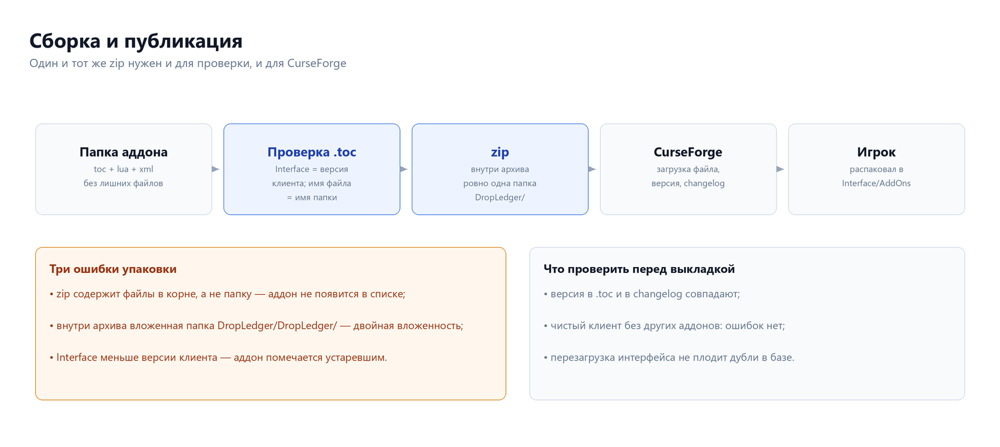

# 11. Публикация, упаковка, версионирование

## 11.1 Зачем это нужно

Аддон, который лежит в вашей папке, — это не аддон. Пока игрок не может скачать zip,
распаковать его и увидеть в списке, работа не закончена. Раздел — про то, как из папки
получается релиз.



## 11.2 Что должно быть в папке

Минимум:

```
МойАддон\МойАддон.toc     — манифест, имя файла = имя папки
МойАддон\Core.lua         — код
МойАддон\UI.lua           — код
```

Плюс по желанию: `Bindings.xml` (привязка клавиш), `Libs\` (внешние библиотеки),
`README.md`, `CHANGELOG.md`.

Чего быть не должно: `.git`, `.vscode`, `tests`, `node_modules`, скриншотов и прочего мусора.
Шаблон FRIKKern исключает их явно (`template/.pkgmeta`, раздел `ignore`):

```
ignore:
  - .github
  - .vscode
  - .luacheckrc
  - .luarc.json
  - .editorconfig
  - .stylua.toml
  - .gitignore
  - README.md
  - CHANGELOG.md
  - tests/
```
— [.pkgmeta](https://github.com/FRIKKern/WoW-Midnight-Addon-Template/blob/main/template/.pkgmeta)

## 11.3 Версия и Interface

| Поле | Правило | Источник |
|---|---|---|
| `## Version` | «The addon version, which will be shown in the tooltip in the AddOn List.» / «Some automatic updating tools may prefer that this begins with a numeric version number.» | [TOC format §Version](https://warcraft.wiki.gg/wiki/TOC_format#Version) |
| `## Interface` | число клиента, например `120105` для 12.1.5 | [TOC format §Interface](https://warcraft.wiki.gg/wiki/TOC_format#Interface) |
| `## X-___` | «Any custom metadata prefixed by "X-"» — сюда кладут ID проектов | [TOC format §X-___](https://warcraft.wiki.gg/wiki/TOC_format#X-___) |

В шаблоне FRIKKern версия подставляется автоматически из git-тега:

```
## Version: @project-version@
```
— [MyAddon.toc](https://raw.githubusercontent.com/FRIKKern/WoW-Midnight-Addon-Template/HEAD/template/MyAddon.toc)

и пояснение из CI: «Replaces @project-version@ tokens in your code»
([release.yml](https://github.com/FRIKKern/WoW-Midnight-Addon-Template/blob/main/template/.github/workflows/release.yml)).

В DropLedger версия проставлена руками (`## Version: 1.13.6`) и дублируется в коде
(`ns.version = "1.13.6"`). Если так делать, надо помнить о синхронизации: расхождение версии
в `.toc` и в коде — классическая путаница при разборе баг-репортов.

ID проектов для авто-загрузки на площадки (шаблон):

```
## X-Curse-Project-ID: 0
## X-Wago-ID: CHANGEME
## X-WoWI-ID: 0
```
— [MyAddon.toc](https://raw.githubusercontent.com/FRIKKern/WoW-Midnight-Addon-Template/HEAD/template/MyAddon.toc)

## 11.4 Структура zip

> «package-as: MyAddon — The folder name inside the zip file. Players see this in /addons. Must
> match your .toc filename (without the extension).»
> — [.pkgmeta](https://github.com/FRIKKern/WoW-Midnight-Addon-Template/blob/main/template/.pkgmeta)

Правильно:

```
MyAddon.zip
└── MyAddon\
    ├── MyAddon.toc
    ├── Core.lua
    └── UI.lua
```

Неправильно (и это самая частая ошибка публикации):

```
MyAddon.zip
├── MyAddon.toc        ← файлы в корне архива: игра не увидит аддон
└── Core.lua
```

```
MyAddon.zip
└── MyAddon\
    └── MyAddon\      ← двойная вложенность
        └── MyAddon.toc
```

Проверка «что увидит игрок»: распаковать zip в пустую папку и убедиться, что внутри ровно одна
папка, а в ней `.toc` с тем же именем.

## 11.5 Сборка: BigWigs packager

Шаблон использует готовый упаковщик. Из `release.yml`:

> «3. Packages the addon using BigWigsMods/packager. 4. Uploads to CurseForge, Wago, WoWInterface,
> and GitHub Releases»
> «The packager automatically: Replaces @project-version@ tokens in your code; Fetches external
> libraries from .pkgmeta; Generates a changelog from git history; Creates the zip file; Uploads
> to all configured platforms»
> — [release.yml](https://github.com/FRIKKern/WoW-Midnight-Addon-Template/blob/main/template/.github/workflows/release.yml)

Ключевые поля `.pkgmeta`, которые надо понимать
([.pkgmeta](https://github.com/FRIKKern/WoW-Midnight-Addon-Template/blob/main/template/.pkgmeta)):

| Поле | Что делает (цитата) |
|---|---|
| `package-as` | имя папки внутри zip |
| `externals` | внешние библиотеки с `url:` + `tag: latest`; «They are NOT committed to your git repo — add Libs/ to .gitignore.» |
| `enable-nolib-creation: yes` | «Creates a second zip without embedded libraries.» |
| `ignore` | список исключаемых файлов/папок |
| `manual-changelog` | ручной changelog (filename/markup-type) |
| `optional-dependencies` | необязательные зависимости |

## 11.6 Два zip: обычный и `-nolib`

`enable-nolib-creation: yes` даёт на выходе два архива:

* **обычный** — со встроенными библиотеками, работает «из коробки»;
* **`-nolib`** — без библиотек; нужен тем, у кого библиотеки уже стоят отдельным аддоном.

Тот же приём виден в самом шаблоне на уровне `.toc`: строки библиотек обёрнуты маркерами,
которые упаковщик вырезает в `-nolib`-сборке —

```
#@no-lib-strip@
Libs\\LibStub\\LibStub.lua
Libs\\CallbackHandler-1.0\\CallbackHandler-1.0.lua
#@end-no-lib-strip@
```
— [MyAddon.toc](https://raw.githubusercontent.com/FRIKKern/WoW-Midnight-Addon-Template/HEAD/template/MyAddon.toc)

## 11.7 Один аддон — несколько клиентов

Если аддон поддерживает и Retail, и Classic, есть два механизма:

1. **Несколько значений в `## Interface`**: `## Interface: 120105, 16001, 50504, 11509`
   ([TOC format §Interface](https://warcraft.wiki.gg/wiki/TOC_format#Interface)).
2. **Разные `.toc` под разные клиенты**: суффиксы `_Mainline`, `_Classic`, `_Mists`, `_Cata`,
   `_Wrath`, `_TBC`, `_Vanilla`; игра «first searches for TOC files with these suffixes … and if
   none are found to match its game type (or its aliases) it will default to `AddOnName.toc`»
   ([TOC format §Naming](https://warcraft.wiki.gg/wiki/TOC_format#Naming)).

Плюс ограничения загрузки:

| Директива | Смысл |
|---|---|
| `## AllowLoadGameType` | грузить только на перечисленных типах (`standard`, `forever`, `mists`, `cata`, `wrath`, `tbc`, `vanilla`, `plunderstorm`, `wowhack`; семейства `mainline`, `classic`) |
| `## ExcludeLoadGameType` | наоборот |
| `## OnlyBetaAndPTR` | только Beta/PTR |

Источник: [TOC format §AllowLoadGameType](https://warcraft.wiki.gg/wiki/TOC_format#AllowLoadGameType),
[§OnlyBetaAndPTR](https://warcraft.wiki.gg/wiki/TOC_format#OnlyBetaAndPTR). И предупреждение
оттуда же, которое стоит прочитать дважды:

> «If at least 1 game type is specified and none of the game types are recognized by the client,
> the condition will still be satisfied. For this reason, you should additionally use
> ExcludeLoadGameType to exclude game types that are not universally recognized yet.»

## 11.8 Категория в списке аддонов

> «Category name displayed in the AddOn List, displayed as a collapsible header entry.» /
> «It is strongly recommended that you stick to the translated category names found on the Addon
> Categories page.»
> — [TOC format §Category](https://warcraft.wiki.gg/wiki/TOC_format#Category)

## 11.9 CI: линтер на каждый пуш

Шаблон прогоняет `luacheck` в GitHub Actions
([lint.yml](https://github.com/FRIKKern/WoW-Midnight-Addon-Template/blob/main/template/.github/workflows/lint.yml)):
`uses: nebularg/actions-luacheck@v1`, `args: -q`, конфиг — `.luacheckrc` в корне.

Зачем это нужно (цитата из `.luacheckrc`
[шаблона](https://github.com/FRIKKern/WoW-Midnight-Addon-Template/blob/main/template/.luacheckrc)):

> «Luacheck catches bugs before they hit production: Undefined global access (typos, missing
> imports); Unused variables (dead code); Shadowed variables…; Unreachable code»

В конфиге: `std = "lua51"`, исключены `Libs`, `Libs/**`, `.release`, `.release/**`.

Важно понимать ограничение: `luacheck` не знает API WoW, поэтому глобалы клиента
(`CreateFrame`, `UIParent`) надо перечислить в конфиге, иначе линтер будет ругаться на каждую
строку. Именно это и делает готовый `wow-luacheckrc`, на который ссылается шаблон.

## 11.10 Релиз по шагам

Порядок, который собирается из источников:

1. `## Version` и `## Interface` соответствуют текущему клиенту (`/dump select(4, GetBuildInfo())`).
2. Локально: чистый клиент, только этот аддон, `/console scriptErrors 1`, `/reload` — ошибок нет.
3. Пуш и тег: «HOW TO RELEASE: git tag v1.0.0 / git push --tags»
   ([release.yml](https://github.com/FRIKKern/WoW-Midnight-Addon-Template/blob/main/template/.github/workflows/release.yml)).
4. CI: lint → packager → загрузка на площадки.
5. Проверка результата: скачать свой же zip с площадки и поставить его в чистый клиент.

> «The 30-second version: Tag your commit, push, wait ~2 minutes, your addon appears on
> CurseForge.» — [publishing.md](https://github.com/FRIKKern/WoW-Midnight-Addon-Template/blob/main/docs-site/docs/publishing.md)

## 11.11 Правила площадок

В трёх источниках правил CurseForge **нет** (это отмечено в плане). Что есть фактически:

* шаблон умеет загружать на CurseForge, Wago, WoWInterface и GitHub Releases и требует секреты
  `CF_API_KEY`, `WAGO_API_TOKEN`, `WOWI_API_TOKEN`, `GITHUB_TOKEN`
  ([release.yml](https://github.com/FRIKKern/WoW-Midnight-Addon-Template/blob/main/template/.github/workflows/release.yml));
* `X-Curse-Project-ID`, `X-Wago-ID`, `X-WoWI-ID` в `.toc` — «These are used by
  BigWigsMods/packager to upload to the correct project»
  ([MyAddon.toc](https://raw.githubusercontent.com/FRIKKern/WoW-Midnight-Addon-Template/HEAD/template/MyAddon.toc)).

Всё остальное (модерация, требования к описанию, лицензия) — вне источников, спрашивать у
куратора.

## 11.12 Частые ошибки новичка

| Симптом | Причина | Источник |
|---|---|---|
| После установки аддона нет в списке | файлы в корне zip | [.pkgmeta](https://github.com/FRIKKern/WoW-Midnight-Addon-Template/blob/main/template/.pkgmeta) |
| «Out of date» у всех | старый `## Interface` | [TOC format §Interface](https://warcraft.wiki.gg/wiki/TOC_format#Interface) |
| Версия в игре старая | забыли обновить `## Version` / тег | [TOC format §Version](https://warcraft.wiki.gg/wiki/TOC_format#Version) |
| Библиотеки не подхватились | `Libs` не в `.toc`, или `externals` не настроены | [MyAddon.toc](https://raw.githubusercontent.com/FRIKKern/WoW-Midnight-Addon-Template/HEAD/template/MyAddon.toc) |
| Аддон грузится на Classic и падает | нет `## Interface` для Classic и/или `AllowLoadGameType` | [§AllowLoadGameType](https://warcraft.wiki.gg/wiki/TOC_format#AllowLoadGameType) |
| CI упал на changelog | `fetch-depth: 0` не выставлен — «Without it, you get an empty changelog» | [release.yml](https://github.com/FRIKKern/WoW-Midnight-Addon-Template/blob/main/template/.github/workflows/release.yml) |

## 11.13 Источники раздела

* [TOC format](https://warcraft.wiki.gg/wiki/TOC_format) — `Interface`, `Version`, `X-`, `Category`, `AllowLoadGameType`, суффиксы имён.
* [AddOn §Installing an addon](https://warcraft.wiki.gg/wiki/AddOn#Installing_an_addon) — что должен увидеть игрок.
* [Getting the current interface number](https://warcraft.wiki.gg/wiki/Getting_the_current_interface_number), [API:GetBuildInfo](https://warcraft.wiki.gg/wiki/API:GetBuildInfo).
* Шаблон FRIKKern: [.pkgmeta](https://github.com/FRIKKern/WoW-Midnight-Addon-Template/blob/main/template/.pkgmeta), [release.yml](https://github.com/FRIKKern/WoW-Midnight-Addon-Template/blob/main/template/.github/workflows/release.yml), [lint.yml](https://github.com/FRIKKern/WoW-Midnight-Addon-Template/blob/main/template/.github/workflows/lint.yml), [.luacheckrc](https://github.com/FRIKKern/WoW-Midnight-Addon-Template/blob/main/template/.luacheckrc), [publishing.md](https://github.com/FRIKKern/WoW-Midnight-Addon-Template/blob/main/docs-site/docs/publishing.md).
* `DropLedger.toc` — пример «ручного» релиза без CI.
