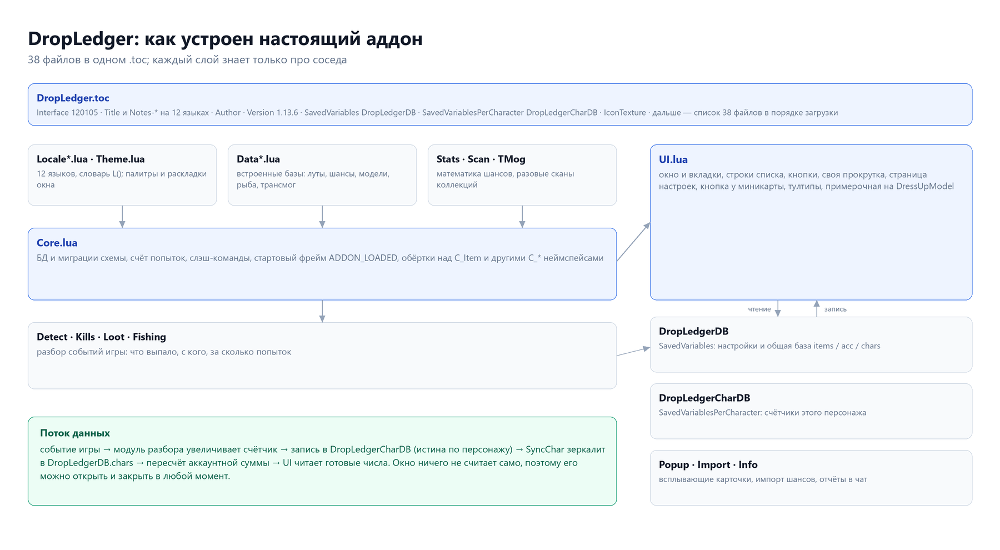
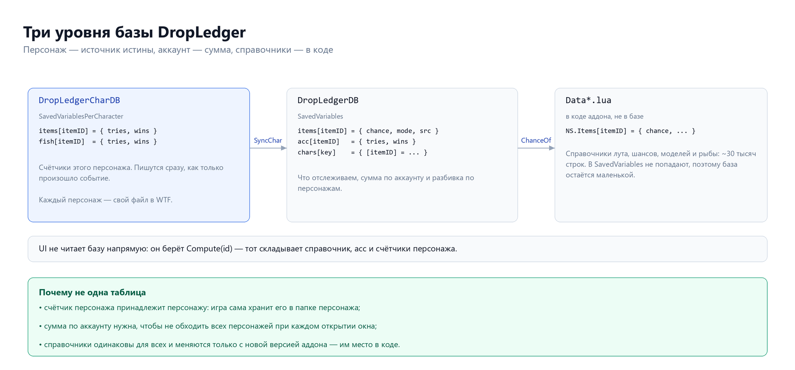

# 12. Два полных примера: Hello World и DropLedger

## 12.1 Зачем этот раздел

До сих пор всё было по частям. Здесь два аддона целиком: минимальный (48 строк, проверен
прогоном) и настоящий (38 файлов, 54 516 строк, живёт в игре). Второй разбирается не целиком —
только те места, которые стажёр будет копировать.

## 12.2 Hello World: файлы

```
examples/hello/
├── HelloWorld.toc
└── HelloWorld.lua
```

### `.toc` построчно

```lua
## Interface: 120105
## Title: Hello World
## Title-ruRU: Привет, мир
## Notes: Минимальный аддон: события, слэш-команда, сохранение счётчика
## Notes-ruRU: Минимальный аддон: события, слэш-команда, сохранение счётчика
## Author: intern
## Version: 1.0.0
## SavedVariables: HelloWorldDB
## IconTexture: Interface\Icons\INV_Misc_QuestionMark

HelloWorld.lua
```

| Строка | Смысл | Источник |
|---|---|---|
| `## Interface: 120105` | клиент, под который собран аддон (12.1.5) | [TOC format §Interface](https://warcraft.wiki.gg/wiki/TOC_format#Interface) |
| `## Title` / `## Title-ruRU` | название в списке аддонов, по языку клиента | [§Title](https://warcraft.wiki.gg/wiki/TOC_format#Title) |
| `## Notes` / `## Notes-ruRU` | подсказка в списке аддонов | [§Notes](https://warcraft.wiki.gg/wiki/TOC_format#Notes) |
| `## Author` | автор | [§Author](https://warcraft.wiki.gg/wiki/TOC_format#Author) |
| `## Version` | версия в подсказке | [§Version](https://warcraft.wiki.gg/wiki/TOC_format#Version) |
| `## SavedVariables: HelloWorldDB` | имя глобальной переменной, которую сохраняет клиент | [§SavedVariables](https://warcraft.wiki.gg/wiki/TOC_format#SavedVariables) |
| `## IconTexture` | иконка в списке | [§IconTexture](https://warcraft.wiki.gg/wiki/TOC_format#IconTexture) |
| `HelloWorld.lua` | единственный файл кода, грузится после всех директив | [§Rules](https://warcraft.wiki.gg/wiki/TOC_format#Rules) |

### `.lua` построчно, блок 1: окружение

```lua
local ADDON, ns = ...
```

Клиент передаёт каждому файлу два параметра: имя аддона и общую таблицу-неймспейс. `ADDON`
нужен, чтобы отличить своё `ADDON_LOADED` от чужих (3.4), `ns` — чтобы файлы видели друг друга
(2.7).

```lua
local DEFAULTS = {
    count = 0,
}
```

Значения по умолчанию держим **в коде**, а не в базе: в базе только то, что меняется. Заодно
это «схема» — по ней видно, что вообще хранится.

### Блок 2: фрейм и подписка

```lua
local frame = CreateFrame("Frame")
frame:RegisterEvent("ADDON_LOADED")
frame:RegisterEvent("PLAYER_LOGIN")
```

`CreateFrame("Frame")` без имени, родителя и шаблона — самый дешёвый объект в игре: он не
рисуется, но умеет получать события ([API:CreateFrame](https://warcraft.wiki.gg/wiki/API:CreateFrame)).
`RegisterEvent` вызывается до `SetScript` — порядок не важен, но так читается логичнее
([API:Frame_RegisterEvent](https://warcraft.wiki.gg/wiki/API:Frame_RegisterEvent)).

### Блок 3: слияние с базой

```lua
local function ApplyDefaults(src, dst)
    dst = dst or {}
    for k, v in pairs(src) do
        if type(v) == "table" then
            dst[k] = ApplyDefaults(v, dst[k])
        elseif dst[k] == nil then
            dst[k] = v
        end
    end
    return dst
end
```

Четыре строки, которые решают проблему «обновил аддон — у игрока нет нового поля». Подробный
разбор — 7.7. Здесь важно, что `dst = dst or {}` закрывает первый запуск, когда `HelloWorldDB`
ещё `nil` ([§Code example](https://warcraft.wiki.gg/wiki/Saving_variables_between_game_sessions#Code_example)).

### Блок 4: обработчик

```lua
frame:SetScript("OnEvent", function(self, event, arg1)
    if event == "ADDON_LOADED" then
        if arg1 ~= ADDON then return end

        HelloWorldDB = ApplyDefaults(DEFAULTS, HelloWorldDB)
        self:UnregisterEvent("ADDON_LOADED")

    elseif event == "PLAYER_LOGIN" then
        print(string.format("|cff33ff99HelloWorld|r: загружен, счётчик = %d",
            HelloWorldDB.count))
    end
end)
```

| Строка | Что делает | Почему так |
|---|---|---|
| `function(self, event, arg1)` | сигнатура обработчика | [Handling events](https://warcraft.wiki.gg/wiki/Handling_events) |
| `if arg1 ~= ADDON then return end` | отсекает чужие аддоны | `ADDON_LOADED` приходит на каждый аддон |
| `HelloWorldDB = ApplyDefaults(...)` | база готова к работе | раньше она `nil` |
| `self:UnregisterEvent("ADDON_LOADED")` | больше не нужен | совет источника |
| `|cff33ff99` … `|r` | цветной текст в чате | escape-последовательности клиента |
| `%d` и `.count` | число | `string.format` из Lua 5.1 |

### Блок 5: команды

```lua
SLASH_HELLOWORLD1 = "/hello"
SLASH_HELLOWORLD2 = "/hw"

SlashCmdList["HELLOWORLD"] = function(msg)
    local cmd, rest = tostring(msg or ""):match("^(%S*)%s*(.-)$")
    cmd = cmd:lower()

    if cmd == "" or cmd == "help" then
        print("|cff33ff99HelloWorld|r: /hello help | count | reset")
    elseif cmd == "count" then
        HelloWorldDB.count = HelloWorldDB.count + 1
        print(string.format("|cff33ff99HelloWorld|r: счётчик = %d", HelloWorldDB.count))
    elseif cmd == "reset" then
        HelloWorldDB.count = 0
        print("|cff33ff99HelloWorld|r: счётчик обнулён")
    else
        print("|cff33ff99HelloWorld|r: неизвестная команда '" .. tostring(cmd) .. "'")
        _ = rest
    end
end
```

| Строка | Что делает | Источник |
|---|---|---|
| `SLASH_HELLOWORLD1/2` | алиасы команды | [Creating a slash command](https://warcraft.wiki.gg/wiki/Creating_a_slash_command) |
| `SlashCmdList["HELLOWORLD"]` | обработчик | там же |
| `msg:match("^(%S*)%s*(.-)$")` | первое слово + остаток | там же (рекомендованный паттерн) |
| `cmd:lower()` | регистронезависимость | наш код |
| `_ = rest` | «остаток сознательно не используем» | стиль, чтобы линтер не ругался |

## 12.3 Как запустить Hello World

1. Создать папку `...\World of Warcraft\_retail_\Interface\AddOns\HelloWorld\`
   ([AddOn §Installing an addon](https://warcraft.wiki.gg/wiki/AddOn#Installing_an_addon)).
2. Положить туда `HelloWorld.toc` и `HelloWorld.lua`; имя файла `.toc` = имя папки.
3. Запустить игру, на экране выбора персонажа нажать «AddOns» и убедиться, что аддон в списке.
4. В игре: `/console scriptErrors 1` ([CVar scriptErrors](https://warcraft.wiki.gg/wiki/CVar_scriptErrors)).
5. Набрать `/hw` — должна появиться справка; `/hw count` — счётчик; `/reload` — счётчик
   сохранился ([MACRO reload](https://warcraft.wiki.gg/wiki/MACRO_reload)).

## 12.4 Тот же аддон без игры: прогон на заглушке

В `tools/miniclient/` лежит крошечная заглушка клиента: `mock.lua` (фрейм, события, `print`,
`SlashCmdList`) и `run.js` (читает `.toc`, грузит файлы в том же порядке, передаёт
`(addonName, namespace)`, потом прогоняет сценарий).

Запуск:

```bash
cd tools/miniclient
NODE_PATH=<путь к node_modules с fengari> node run.js ../../examples/hello
```

Фактический вывод прогона:

```
|cff33ff99HelloWorld|r: загружен, счётчик = 0
|cff33ff99HelloWorld|r: /hello help | count | reset
|cff33ff99HelloWorld|r: счётчик = 1
|cff33ff99HelloWorld|r: счётчик = 2
|cff33ff99HelloWorld|r: счётчик обнулён
|cff33ff99HelloWorld|r: неизвестная команда 'бред'
ok: приветствие после PLAYER_LOGIN
ok: справка по /hello
ok: инкремент счётчика
ok: сброс счётчика
ok: ругань на неизвестную команду
ok: чужой ADDON_LOADED проигнорирован
ИТОГ: все проверки пройдены
```

Что этот прогон **доказывает**: синтаксис Lua 5.1 корректен, `...` разбирается, `ADDON_LOADED`
фильтруется, слэш-обработчик работает, `ApplyDefaults` не падает на `nil`.
Чего он **не доказывает**: вид окна, шрифты, поведение в бою. Это отмечено и в 13.6.

Заглушка — не замена игре, а способ поймать 80 % ошибок до запуска клиента. Важно: `fengari`
даёт настоящий Lua 5.1, поэтому проверяется именно тот язык, который в игре
([Lua](https://warcraft.wiki.gg/wiki/Lua): «Only a subset of version 5.1…»).

## 12.5 DropLedger: что это и почему «средний»

Аддон считает попытки и выпадения редких предметов, хранит статистику по персонажу и аккаунту,
умеет импортировать шансы и показывает, сколько попыток осталось до «гарантии».

Размер: **38 файлов, 54 516 строк**, из них ~30 тысяч — сгенерированные справочники данных.
Живого кода примерно 20 тысяч строк. Это уже не Hello World, но ещё не ElvUI.



## 12.6 Файлы и порядок загрузки

Порядок в `.toc` — не алфавит, а зависимости:

| Группа | Файлы | Зачем в этом порядке |
|---|---|---|
| Локализация | `Locale.lua`, `Locale_*.lua` (12 шт.) | словари должны существовать до первого `L(...)` в других файлах |
| Оформление | `Theme.lua` | палитры нужны и ядру, и UI |
| Ядро | `Core.lua` | создаёт `ns`, базу, `L`, обёртки API |
| Данные | `Data.lua`, `DataBuiltin.lua`, `DataWowhead.lua`, `DataInfo.lua`, `DataLoot.lua`, `DataFish.lua`, `DataMogWowhead.lua`, `DataRaceModels.lua` | справочники читаются ядром и UI |
| Логика | `Loot.lua`, `Info.lua`, `Professions.lua`, `Fishing.lua`, `Stats.lua`, `Detect.lua`, `Kills.lua`, `Scan.lua`, `TMog.lua`, `Sets.lua`, `Import.lua` | используют ядро и данные |
| Интерфейс | `UI.lua`, `Popup.lua` | использует всё вышеперечисленное |

Урок: **порядок в `.toc` — это граф зависимостей, записанный линейно.** Если файл начинает
использовать что-то, чего ещё нет, — либо двигайте файл вниз, либо не обращайтесь к этому на
этапе загрузки.

## 12.7 Три уровня базы

```
DropLedgerCharDB (SavedVariablesPerCharacter)
    items[itemID] = { tries, wins }        — счётчики ЭТОГО персонажа
    fish[itemID]  = { tries, wins }        — рыбалка этого персонажа

DropLedgerDB (SavedVariables, аккаунт)
    items[itemID]  = { chance, mode, src, note }   — что и как отслеживаем
    acc[itemID]    = { tries, wins }                — сумма по всем персонажам
    chars[key]     = { [itemID] = { tries, wins } } — разбивка по персонажам
    settings, ui                                    — настройки
```

Почему три, а не одно:



* **`SavedVariablesPerCharacter`** — то, что физически принадлежит персонажу (его попытки).
* **`acc`** — сумма, чтобы игрок видел «всего по аккаунту» без обхода всех персонажей.
* **`chars`** — чтобы показать разбивку и не потерять данные персонажа, которого сейчас нет
  в игре.

Правило синхронизации (из шапки `Core.lua`): «Персонаж считается источником истины: при входе
его счётчики зеркалятся в `DropLedgerDB.chars`, а аккаунтная сумма пересчитывается по всем
персонажам».

Формально `acc` можно было бы всегда вычислять из `chars`, но тогда каждое открытие окна
делало бы обход всей базы. Кэш — это осознанный компромисс, и он описан в коде, а не выведен
из головы.

## 12.8 Загрузка: что происходит по шагам

Разбор `Core.lua:1031-1130` (сам код — в 3.6). По шагам, с объяснением **почему**:

1. `pcall(ns.SyncChar)` — слить счётчики персонажа в аккаунтную базу. Обёрнуто, потому что
   битая база у одного игрока не должна мешать остальным 99 % войти.
2. Миграции (`npcKillAsked`, `msgOnByDefault`) — одноразовые переключатели поведения (7.7).
3. `ns.FillBuiltin({ silent = true })` — залить встроенный справочник при первом запуске.
   Тоже в `pcall`: разбор 3 800 предметов не должен ломать загрузку.
4. `ns:RegisterSlash()` — команды нужны раньше окна: если UI упал, `/dl` всё равно должен
   работать.
5. `C_Timer.After(0, StartDetect)` — регистрация игровых событий на следующий кадр.
6. `ns.UI.OnLoad()` — построить окно.
7. Приветствие в чат, если база пустая (`welcomed`).

Порядок не случаен: сначала данные, потом команды, потом события, потом интерфейс. Если
поменять 6 и 5 местами, окно может открыться до того, как подписаны события, и первые
выпадения потеряются.

## 12.9 Обработка выпадения: `HandleDrop`

`Detect.lua:260-300` — центральная точка, куда сходятся все пути (окно добычи, чат, событие
босса). Первые 20 строк:

```lua
function ns.HandleDrop(itemID, source)
    itemID = tonumber(itemID)
    if not itemID then return end

    --  одно и то же выпадение приходит разными путями (окно добычи, чат,
    --  событие босса): второй заход в пределах двух секунд — это дубль
    local now = type(GetTime) == "function" and GetTime() or 0
    if now > 0 and lastDropAt[itemID] and (now - lastDropAt[itemID]) < 2 then return end
    lastDropAt[itemID] = now

    local tracked = ns.IsTracked(itemID)
    local owned = ns.ItemOwned(itemID)

    if not tracked then
        if not ns.db.settings.autoAdd or owned then return end
        local _, _, quality, _, _, _, _, _, _, _, _, classID = ns.ItemInfoTuple(itemID)
        local rare = (quality and quality >= ns.db.settings.minQuality) or classID == 9 or ns.Items[itemID]
        if not rare then return end
        ns.TrackItem({ id = itemID, mode = "manual", note = L("автодобавлено") })
        ...
```

| Приём | Зачем |
|---|---|
| `tonumber(itemID)` + `return` | всё, что пришло извне, может быть строкой или `nil` |
| окно в 2 секунды | одно выпадение приходит 2–3 событиями (9.8) |
| `type(GetTime) == "function"` | код переиспользуется в тестах, где `GetTime` может отсутствовать |
| отдельно `tracked` и `owned` | «отслеживаем» и «уже есть» — разные вещи: второе гасит сообщения |
| `ns.ItemInfoTuple` | обёртка над `C_Item.GetItemInfo`, которая возвращает `nil` вместо падения (9.4) |
| `classID == 9` | рецепты (profession) считаются редкими отдельно |

## 12.10 Математика ожидания

`Stats.lua:131-141` — две формулы, на которых держится вся ценность аддона:

```lua
--- Сколько попыток нужно, чтобы с вероятностью conf предмет выпал хотя бы раз.
function ns.NeedAttempts(chance, conf)
    if not chance or chance <= 0 then return nil end
    if chance >= 1 then return 1 end
    return math.ceil(math.log(1 - conf) / math.log(1 - chance))
end

--- Вероятность не получить предмет за n попыток.
function ns.NoDropChance(chance, n)
    if not chance or chance <= 0 or not n or n <= 0 then return 1 end
    if chance >= 1 then return 0 end
    return (1 - chance) ^ n
end
```

Проверим на живом примере: предмет с шансом 0.5 % (`chance = 0.005`).

* `NeedAttempts(0.005, 0.90)` = `ceil(ln(0.10)/ln(0.995))` = `ceil(459.4)` = **460** попыток.
* `NeedAttempts(0.005, 0.95)` = `ceil(ln(0.05)/ln(0.995))` = `ceil(597.6)` = **598** попыток.
* `NoDropChance(0.005, 100)` = `0.995^100` ≈ **0.606** — за 100 попыток предмет не выпадет с
  вероятностью 60.6 %.

Именно эти три числа игрок и хочет видеть: «сколько ещё», «сколько всего» и «насколько я
невезучий». Все они выводятся из одного числа — шанса, который берётся из базы или справочника
(`ChanceOf`, `Stats.lua:107-125`).

Обратите внимание на защиту от деления на ноль: `chance >= 1 → 1`, `chance <= 0 → nil`.
Без неё `math.log(0)` вернёт `-inf` и интерфейс покажет мусор.

## 12.11 Локализация: 12 языков одной функцией

`Locale.lua` — словари «русская строка → перевод»:

```lua
function ns.L(s, ...)
    if type(s) ~= "string" then return s end
    if Locale.current ~= "ru" then
        local d = Locale.dict[Locale.current]
        if d then
            local tr = d[s]
            if tr then s = tr end
        end
    end
    if select("#", ...) > 0 then
        local ok, res = pcall(string.format, s, ...)
        if ok then return res end
    end
    return s
end
```

Решения, которые стоит забрать в свой аддон:

| Решение | Почему |
|---|---|
| русский — исходный текст | не нужен словарь `ru`, и код читается по-русски |
| нет перевода → остаётся русский | лучше русская строка, чем пустота |
| `pcall(string.format, ...)` | лишний аргумент `%d` не должен ронять аддон |
| язык берётся из `GetLocale()` | «незнакомый клиент → английский» |
| иероглифы только на родном клиенте | в западных шрифтах их нет — будут «квадратики» (`Locale.Supported`) |

## 12.12 Тема: цвета отдельно от геометрии

`Theme.lua` разделяет две вещи, которые новички смешивают:

* **палитра** — таблицы `C.*` (цвета), которые переписываются на месте;
* **раскладка** — `LAY.*` (где что стоит).

Смысл: 8 палитр × 8 раскладок = 64 вида без дублирования кода. В `UI.lua` элементы читают
`C.text`, `C.panel` и т. д. **в момент отрисовки**, поэтому смена палитры применяется к уже
созданным фреймам без пересборки окна.

Урок для стажёра: если цвет зашит в `SetBackdropColor(0.1, 0.1, 0.1, 1)` в двадцати местах,
сменить тему нельзя. Если цвет лежит в `C.panel` — можно.

## 12.13 Что бы я сделал иначе (честный раздел)

| Что | Как сейчас | Как лучше |
|---|---|---|
| Обёртки `C_Item` | 50 строк на два формата возврата | вынести в отдельный `Compat.lua` с одной таблицей версий клиента |
| `UI.lua` 7 105 строк | один файл | разбить по вкладкам: `UI/List.lua`, `UI/Prof.lua`… |
| Миграции | флаги `npcKillAsked`, `msgOnByDefault` | одна таблица `db.migrations = { npcKillAsked = true }` |
| Версия | руками в `.toc` и в `Core.lua` | подставлять из тега (как в шаблоне, `@project-version@`) |
| Тесты | `tools/uitest` с ручными сценариями | добавить прогон в CI (11.9) |

Эти пункты — не «ошибки», а долг, который накопился за 13 версий. Их полезно видеть, чтобы не
повторять.

## 12.14 Частые ошибки, которые видны именно на примере DropLedger

| Ошибка | Как выглядит | Где лечится |
|---|---|---|
| Считать одно выпадение трижды | счётчик растёт быстрее, чем падает лут | 12.9, окно 2 секунды |
| Хранить справочник в `SavedVariables` | база 20 МБ, `SAVED_VARIABLES_TOO_LARGE` | 7.9 |
| Писать UI до данных | пустые строки при первом входе | 12.8, порядок шагов |
| Локализовать формат `%s` вместо текста | `string.format` падает на чужом переводе | `pcall` в 12.11 |
| Дублировать шансы в трёх таблицах | рассинхрон цифр в окне и в чате | `ChanceOf` — единая точка |

## 12.15 Источники раздела

* `examples/hello/HelloWorld.toc`, `examples/hello/HelloWorld.lua` — полный текст примера.
* `tools/miniclient/mock.lua`, `tools/miniclient/run.js` — прогон без игры.
* `DropLedger/DropLedger.toc` — порядок 38 файлов.
* `DropLedger/Core.lua` — `ns`, `ApplyDefaults`, `ItemInfoTuple`, загрузка, слэш.
* `DropLedger/Detect.lua` — `HandleDrop`, `OnChatLoot`, регистрация событий.
* `DropLedger/Stats.lua` — `ChanceOf`, `NeedAttempts`, `NoDropChance`, `Compute`.
* `DropLedger/Locale.lua`, `DropLedger/Theme.lua` — локализация и палитры.
* API-факты в этом разделе — по разделам 3–9 и их источникам.
