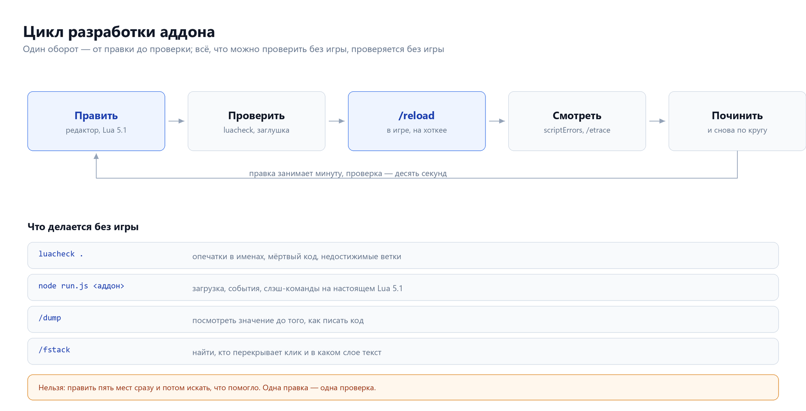

# 13. Процесс разработки человеком: среда, цикл, приёмка

## 13.1 Что нужно на старте

| Что | Требование | Источник |
|---|---|---|
| Клиент игры | «You need a WoW installation (Retail, PTR, or Beta).» | [getting-started.md](https://github.com/FRIKKern/WoW-Midnight-Addon-Template/blob/main/docs-site/docs/getting-started.md) |
| Папка аддона | `...\_retail_\Interface\AddOns\Имя\` | [AddOn §Installing an addon](https://warcraft.wiki.gg/wiki/AddOn#Installing_an_addon) |
| Права на запись | папка игры должна быть доступна на запись (иначе `.toc` не сохранится) | следствие установки |
| Git | не обязателен для запуска, но нужен для релиза (11.10) | [publishing.md](https://github.com/FRIKKern/WoW-Midnight-Addon-Template/blob/main/docs-site/docs/publishing.md) |
| Редактор | любой, но см. 13.2 | [Lua editors](https://warcraft.wiki.gg/wiki/Lua_editors) |

Отдельный «тестовый клиент» в источниках явно не рекомендуется и не описан — есть только
формулировка «Retail, PTR, or Beta» и процедура очистки `Cache\WDB`, `WTF`, `Interface`, если
нужно вернуть чистый UI
([UI FAQ/AddOns](https://warcraft.wiki.gg/wiki/UI_FAQ/AddOns)). Это отмечено в плане как
непокрытое.

## 13.2 Редактор и его настройка

> «While any text editor can edit Lua files, many contain additional Lua specific features.» /
> «Visual Studio Code is recommended with the WoW API extension.»
> — [Lua editors](https://warcraft.wiki.gg/wiki/Lua_editors)

Страница перечисляет десятки редакторов (Notepad++, Sublime Text, ZeroBrane Studio, IntelliJ,
SciTE, Emacs…), но рекомендация одна — VS Code + расширение WoW API. Шаблон FRIKKern
фиксирует набор расширений файлом `template/.vscode/extensions.json`:

* `sumneko.lua` — языковой сервер Lua (автодополнение, переходы, диагностика);
* `ketho.wow-api` — определения WoW API (то самое расширение из вики);
* `johnnymorganz.stylua` — форматтер.

И настройки `template/.vscode/settings.json`, которые надо повторить у себя:

```json
{
  "Lua.runtime.version": "Lua 5.1",
  "Lua.diagnostics.globals": ["issecretvalue", "SlashCmdList"],
  "files.associations": { "*.toc": "ini" }
}
```

Зачем каждая строка:

| Настройка | Что даёт |
|---|---|
| `Lua.runtime.version: "Lua 5.1"` | не подсказывает `goto`, `//`, битовые операторы — их в клиенте нет ([Lua](https://warcraft.wiki.gg/wiki/Lua)) |
| `Lua.diagnostics.globals` | глобалы WoW не считаются «undefined» (иначе сотни ложных предупреждений) |
| `*.toc → ini` | подсветка директив `.toc` как ini-файла |

Про отладчик: «Eclipse + … LDT includes … a debugger (not usable w/ WoW though, since it needs
LuaSocket» ([Lua editors](https://warcraft.wiki.gg/wiki/Lua_editors)). То есть **пошагового
отладчика для WoW нет** — отладка только через печать, `/dump`, `/fstack` и `taintLog`.

## 13.3 Линтер: ловит то, что не видно глазами

`.luacheckrc` из шаблона ([ссылка](https://github.com/FRIKKern/WoW-Midnight-Addon-Template/blob/main/template/.luacheckrc)):

> «Luacheck catches bugs before they hit production: Undefined global access (typos, missing
> imports); Unused variables (dead code); Shadowed variables…; Unreachable code»

Настройки: `std = "lua51"`, исключены `Libs`, `Libs/**`, `.release`, `.release/**`.

Запуск локально:

```bash
luacheck .            # из папки аддона
```

Важно: `luacheck` не знает API WoW. Глобалы (`CreateFrame`, `UIParent`, `issecretvalue`) надо
перечислить в конфиге — именно это делает готовый `wow-luacheckrc`, на который ссылается шаблон.

Почему это часть процесса, а не «приятное дополнение»: опечатка `RegistrEvent` в Lua не ошибка
— это обращение к `nil`, и вы увидите её только когда событие не придёт. Линтер видит такое
сразу.

## 13.4 Структура проекта и git

Минимум, который стоит завести с первого дня:

```
МойАддон\                 ← это и есть папка аддона, её видят игроки
├── .git\                 ← история
├── .gitignore            ← Libs\, .release\, *.zip
├── .luacheckrc
├── МойАддон.toc
├── Core.lua
├── UI.lua
└── Libs\                 ← НЕ коммитим, если libs тянутся упаковщиком
```

Шаблон добавляет `.pkgmeta`, `.github/workflows/lint.yml`, `.github/workflows/release.yml`,
`CHANGELOG.md` ([дерево template/](https://github.com/FRIKKern/WoW-Midnight-Addon-Template/tree/main/template)).

Почему `Libs` не коммитят: «They are NOT committed to your git repo — add Libs/ to .gitignore»
([.pkgmeta](https://github.com/FRIKKern/WoW-Midnight-Addon-Template/blob/main/template/.pkgmeta)).
Упаковщик сам скачает нужные версии при сборке.

## 13.5 Цикл разработки: правка → `/reload` → проверка



Это главный цикл, и он короче, чем кажется:

1. Правите `.lua` (или `.xml`).
2. В игре: `/reload` — «Reloads the user interface»
   ([MACRO reload](https://warcraft.wiki.gg/wiki/MACRO_reload)).
3. Проверяете.

Что подхватывается без перезапуска игры:

> «Newly created/added files (and even complete addons) are detected when doing a `/reload` after
> the game has started.» / «If you delete or rename a TOC file already loaded by the game you will
> however need a full game restart.» — [TOC format §Rules](https://warcraft.wiki.gg/wiki/TOC_format#Rules)

| Действие | Нужен `/reload` | Нужен перезапуск игры |
|---|---|---|
| изменил код в существующем файле | да | нет |
| добавил новый `.lua` и строку в `.toc` | да | нет |
| добавил новый аддон целиком | да | нет |
| удалил/переименовал `.toc` | — | **да** |
| изменил `## SavedVariables` | — | лучше да (проверить, что файл создался) |

Полезные привычки:

* **`/reload` на хоткее.** «you may want to put it on a macro hotkey»
  ([Create a WoW AddOn in 15 Minutes](https://warcraft.wiki.gg/wiki/Create_a_WoW_AddOn_in_15_Minutes)).
  Макрос: `/reload`.
* **Выключить лишние аддоны** на время отладки — «temporarily disabling any unnecessary addons
  that would increase loading time» (там же).
* **Каждое изменение — один вопрос.** Не править пять мест сразу: потом не понять, что помогло.

## 13.6 Где смотреть ошибки

| Инструмент | Что показывает | Как включить |
|---|---|---|
| Окно `Lua Error` | текст ошибки, файл, строка, аддон | `/console scriptErrors 1` ([CVar scriptErrors](https://warcraft.wiki.gg/wiki/CVar_scriptErrors)) |
| `Lua Error` после старта | ошибки, случившиеся до открытия чата | BugGrabber/BugSack — «records all errors (including those fired during startup) for later examination» ([Useful AddOns for debugging/profiling](https://warcraft.wiki.gg/wiki/Useful_AddOns_for_debugging/profiling)) |
| `taint.log` | кто испортил Blizzard-интерфейс | `/console taintLog 1`, перезапуск, воспроизвести, выйти и искать слово `blocked` ([AddOn](https://warcraft.wiki.gg/wiki/AddOn)) |
| Текстовые логи ошибок | ошибки в защищённых путях | CVar `luaErrorExceptions` = 1 (по умолчанию) ([CVar luaErrorExceptions](https://warcraft.wiki.gg/wiki/CVar_luaErrorExceptions)) |
| Свой чат-канал | то, что вы сами печатаете | `ns.Debug` + `/dl debug` (10.7) |

Порядок разбора любой жалобы «не работает»:

1. Включить `scriptErrors`, повторить, посмотреть, есть ли ошибка.
2. Если ошибки нет — проверить, что аддон вообще загрузился: `/dump C_AddOns.IsAddOnLoaded("МойАддон")`
   ([API:C_AddOns.IsAddOnLoaded](https://warcraft.wiki.gg/wiki/API:C_AddOns.IsAddOnLoaded)).
3. Если загрузился — проверить, что нужное событие приходит: `/etrace`
   ([MACRO eventtrace](https://warcraft.wiki.gg/wiki/MACRO_eventtrace)).
4. Если приходит — печатать аргументы: `/dump` или свой лог.
5. Если не приходит — проверить регистрацию: `IsEventRegistered`
   ([API:Frame_IsEventRegistered](https://warcraft.wiki.gg/wiki/API:Frame_IsEventRegistered)).

## 13.7 Проверка без игры

Источники этот приём не описывают (это не вики-материал), но он есть в нашем проекте и
экономит часы: `tools/miniclient/` прогоняет аддон на настоящем Lua 5.1 (`fengari`) с
заглушкой клиента.

Что проверяется:

* синтаксис всех файлов;
* порядок загрузки ровно как в `.toc`;
* `ADDON_LOADED` только для своего аддона;
* `ApplyDefaults` не падает на `nil`;
* слэш-команды и их аргументы;
* отсутствие обращений к несуществующим глобалам (если заглушка их не определяет).

Что **не** проверяется и требует игры:

* вид окна, шрифты, наложения;
* поведение в бою, taint, secret values;
* реальные события и их аргументы;
* производительность.

Правило: **заглушка — фильтр перед игрой, а не замена.** Нашли ошибку в игре — добавьте
проверку в заглушку, чтобы второй раз не искать.

## 13.8 Как понять, что всё пройдёт правильно: приёмка

Чек-лист, собранный из требований источников и нашего опыта. Пункт считается пройденным,
только если проверен руками.

### Загрузка

- [ ] Аддон виден в списке аддонов, иконка и описание на месте
      ([AddOn](https://warcraft.wiki.gg/wiki/AddOn)).
- [ ] `Interface` совпадает с клиентом: `/dump select(4, GetBuildInfo())`
      ([API:GetBuildInfo](https://warcraft.wiki.gg/wiki/API:GetBuildInfo)).
- [ ] В чате нет ошибок при входе с `scriptErrors 1`.
- [ ] `/reload` не даёт ошибок и не дублирует окно/сообщения
      ([MACRO reload](https://warcraft.wiki.gg/wiki/MACRO_reload)).

### Данные

- [ ] При самом первом запуске (база удалена) аддон работает, база создаётся.
- [ ] После выхода из игры файл базы появился в
      `WTF\Account\...\SavedVariables\МойАддон.lua`
      ([§Storage](https://warcraft.wiki.gg/wiki/Saving_variables_between_game_sessions#Storage)).
- [ ] Настройки переживают `/reload` и перезаход.
- [ ] Второй персонаж видит свои данные, а не данные первого (если используются
      `SavedVariablesPerCharacter`).

### Интерфейс

- [ ] Окно открывается и закрывается, Esc работает (если задумано)
      ([Make frames closable with the Escape key](https://warcraft.wiki.gg/wiki/Make_frames_closable_with_the_Escape_key)).
- [ ] Окно двигается и не уезжает за экран за край
      ([API:Frame_SetClampedToScreen](https://warcraft.wiki.gg/wiki/API:Frame_SetClampedToScreen)).
- [ ] Смена масштаба интерфейса не ломает вид (`UI_SCALE_CHANGED`
      ([Event:UI_SCALE_CHANGED](https://warcraft.wiki.gg/wiki/Event:UI_SCALE_CHANGED))).
- [ ] Другое разрешение экрана — окно на месте.

### Поведение

- [ ] Событие обрабатывается один раз (нет двойного счёта).
- [ ] В бою нет ошибок `ADDON_ACTION_BLOCKED`/`FORBIDDEN`
      ([Event:ADDON_ACTION_BLOCKED](https://warcraft.wiki.gg/wiki/Event:ADDON_ACTION_BLOCKED)).
- [ ] В подземелье нет ошибок про secret values (9.10).
- [ ] Слэш-команды отвечают на все подкоманды, включая неизвестную.

### Локализация

- [ ] На английском клиенте нет русского текста (если заявлена поддержка).
- [ ] Длинные переводы не вылезают за кнопки.
- [ ] `L("%s")` с аргументами не падает (12.11).

### Чистота

- [ ] Аддон работает один, без других аддонов (папка `Interface` с одним аддоном).
- [ ] `luacheck` чистый (11.9).
- [ ] В `.toc` нет файлов, которых нет в папке.

## 13.9 Разбор типовых поломок: что смотреть

| Симптом | Где искать | Что проверить |
|---|---|---|
| `attempt to index a nil value` | окно ошибки, файл:строка | порядок в `.toc`, `SavedVariables` до `ADDON_LOADED` |
| `attempt to call a nil value (global 'X')` | там же | функция удалена/переименована (9.2), или это FrameXML-функция без `framexml`-тега |
| `secret ...` | там же | сравнение/арифметика на значении клиента (9.10) |
| `Interface action failed because of an AddOn` | чат + `taint.log` | вы трогаете защищённый фрейм (10.5) |
| Событие «не приходит» | `/etrace` | регистрация, правильное имя события, `RegisterUnitEvent` вместо `RegisterEvent` |
| Событие приходит дважды | `/etrace` + свой лог | два фрейма регистрируют одно событие, или дубль от разных путей (12.9) |
| Окно «не там» | `/fstack` | якоря: часть к `UIParent`, часть к окну (4.3) |
| Текст не видно | `/fstack` + Shift | слой отрисовки (4.6) |
| Кнопка не нажимается | `/fstack` | перекрыта другим фреймом, `EnableMouse`, страта |
| Лаги | `/dl perf`, `debugprofilestop` | пул строк, `OnUpdate`, тяжёлые сканы (10.8) |
| Всё работает, но «не сохраняется» | файл базы в `WTF` | имя переменной в `.toc`, глобальность (7.10) |

## 13.10 Работа с чужими аддонами и чистый клиент

Если нужно понять, виноват ли ваш аддон:

> «Make a list of all AddOns that you have loaded. Disable them all. Yep. All of them.» … «If you
> have a ton of AddOns, you may want to do a "binary search"»
> — [UI FAQ/AddOns](https://warcraft.wiki.gg/wiki/UI_FAQ/AddOns)

Сброс интерфейса до заводского:

> «Delete the Cache\WDB and WTF folders from your World of Warcraft directory, and rename the
> "Interface" folder to something else, e.g. "Interface Backup".» — там же.

И совет, который спасает нервы: «It is generally an excellent idea to maintain regular backups of
the Interface folder … and the WTF folder» (там же).

## 13.11 Симуляция ограничений 12.x

Не обязательно идти в подземелье, чтобы проверить, как аддон переживёт секретные значения:

> «A handful of console variables are available to simulate secrecy. They will not be saved
> across game restarts.» — [Secret Values](https://warcraft.wiki.gg/wiki/Secret_Values)

| CVar | Что симулирует |
|---|---|
| `addonCombatRestrictionsForced` | «guarded in combat» |
| `addonEncounterRestrictionsForced` | «guarded in active encounters» |
| `addonChallengeModeRestrictionsForced` | «guarded by challenge mode and mythic plus status» |
| `addonPvPMatchRestrictionsForced` | «guarded by PvP match state» |
| `addonMapRestrictionsForced` | «APIs guarded by current map type will be restricted, or may return secrets» |
| `addonChatRestrictionsForced` | ограничения чата в lockdown |

Ставить через `/console`, снимать — вернуть `0`. После перезапуска игры они и так сбрасываются.

## 13.12 Релиз как часть процесса

Процесс не заканчивается на «у меня работает». Минимум:

1. `## Version` поднят, `## Interface` актуален (11.3).
2. Прогон по чек-листу 13.8 на чистом клиенте.
3. Коммит и тег: `git tag v1.0.0 && git push --tags`
   ([release.yml](https://github.com/FRIKKern/WoW-Midnight-Addon-Template/blob/main/template/.github/workflows/release.yml)).
4. CI: lint → packager → загрузка.
5. Скачать свой zip с площадки и поставить в чистый клиент — «проверка глазами игрока» (11.4).

## 13.13 Типичный день стажёра

| Время | Что делает |
|---|---|
| 9:00 | `git pull`, посмотреть, что изменилось; запустить `luacheck .` |
| 9:15 | Запустить игру, `/console scriptErrors 1`, проверить, что вчерашнее состояние грузится без ошибок |
| 9:30 | Задача: добавить X. Сначала — прочитать, где X живёт в коде (`grep` по `ns.`), потом писать |
| 10:30 | Первая версия: минимальный код, `/reload`, проверить в чате/окне |
| 11:00 | Добавить строчку в свой отладочный лог (`ns.Debug`), если не видно, что происходит |
| 12:00 | Проверить крайние случаи: база пустая, персонаж другой, окно закрыто, бой |
| 14:00 | Прогнать заглушку (`tools/miniclient`), добавить проверку на найденную ошибку |
| 15:00 | Тест на «чистом» клиенте: только этот аддон |
| 16:00 | `luacheck`, коммит с осмысленным сообщением, обновить `## Version`, если это релиз |
| 17:00 | Записать в `CHANGELOG.md`, что изменилось и почему |

## 13.14 Частые ошибки процесса

| Ошибка | Чем плохо | Как правильно |
|---|---|---|
| Отладка без `scriptErrors` | «ошибок нет» = ошибки не видны | включить сразу (13.6) |
| Правка без `/reload` | старый код в памяти, ложные выводы | `/reload` после каждой правки |
| «У меня работает» без чистого клиента | конфликт с другим аддоном | тест в папке с одним аддоном |
| Тест только на своём персонаже | `SavedVariablesPerCharacter` и другой класс ведут себя иначе | второй персонаж, пустая база |
| Коммит раз в неделю | невозможно понять, что сломало | коммит на каждую законченную мысль |
| Нет `.luacheckrc` | опечатки ловятся игрой, а не линтером | конфиг из 13.3 |
| Печать `print` в релизе | мусор в чате у игроков | `ns.Debug` + флаг |
| Игнор `taint.log` | «ломается чужой аддон», а виноват ваш | 10.5 |

## 13.15 Источники раздела

* [Lua editors](https://warcraft.wiki.gg/wiki/Lua_editors) — редакторы и рекомендация VS Code + WoW API.
* [Create a WoW AddOn in 15 Minutes](https://warcraft.wiki.gg/wiki/Create_a_WoW_AddOn_in_15_Minutes) — `/reload`, `scriptErrors`, `/dump`, `/etrace`, `/fstack`.
* [TOC format §Rules](https://warcraft.wiki.gg/wiki/TOC_format#Rules) — что подхватывается на `/reload`, а что требует рестарта.
* [MACRO reload](https://warcraft.wiki.gg/wiki/MACRO_reload), [CVar scriptErrors](https://warcraft.wiki.gg/wiki/CVar_scriptErrors), [CVar luaErrorExceptions](https://warcraft.wiki.gg/wiki/CVar_luaErrorExceptions), [CVar taintLog](https://warcraft.wiki.gg/wiki/CVar_taintLog).
* [Lua Error](https://warcraft.wiki.gg/wiki/Lua_Error), [Blizzard DebugTools](https://warcraft.wiki.gg/wiki/Blizzard_DebugTools).
* [AddOn](https://warcraft.wiki.gg/wiki/AddOn) — установка, out-of-date, диагностика taint.
* [UI FAQ/AddOns](https://warcraft.wiki.gg/wiki/UI_FAQ/AddOns) — бинарный поиск виновника, сброс UI, бэкапы.
* [Useful AddOns for debugging/profiling](https://warcraft.wiki.gg/wiki/Useful_AddOns_for_debugging/profiling) — BugGrabber/BugSack и профилирование.
* [Secret Values](https://warcraft.wiki.gg/wiki/Secret_Values) — CVar'ы симуляции ограничений.
* Шаблон FRIKKern: [getting-started.md](https://github.com/FRIKKern/WoW-Midnight-Addon-Template/blob/main/docs-site/docs/getting-started.md), [publishing.md](https://github.com/FRIKKern/WoW-Midnight-Addon-Template/blob/main/docs-site/docs/publishing.md), [.luacheckrc](https://github.com/FRIKKern/WoW-Midnight-Addon-Template/blob/main/template/.luacheckrc), [.vscode/](https://github.com/FRIKKern/WoW-Midnight-Addon-Template/tree/main/template/.vscode).
* `tools/miniclient/`, `examples/hello/` — наш прогон без игры.
